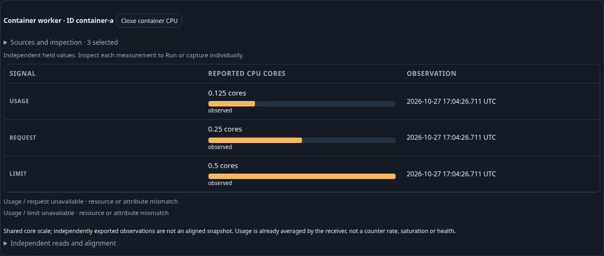
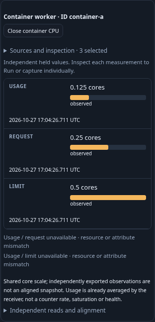
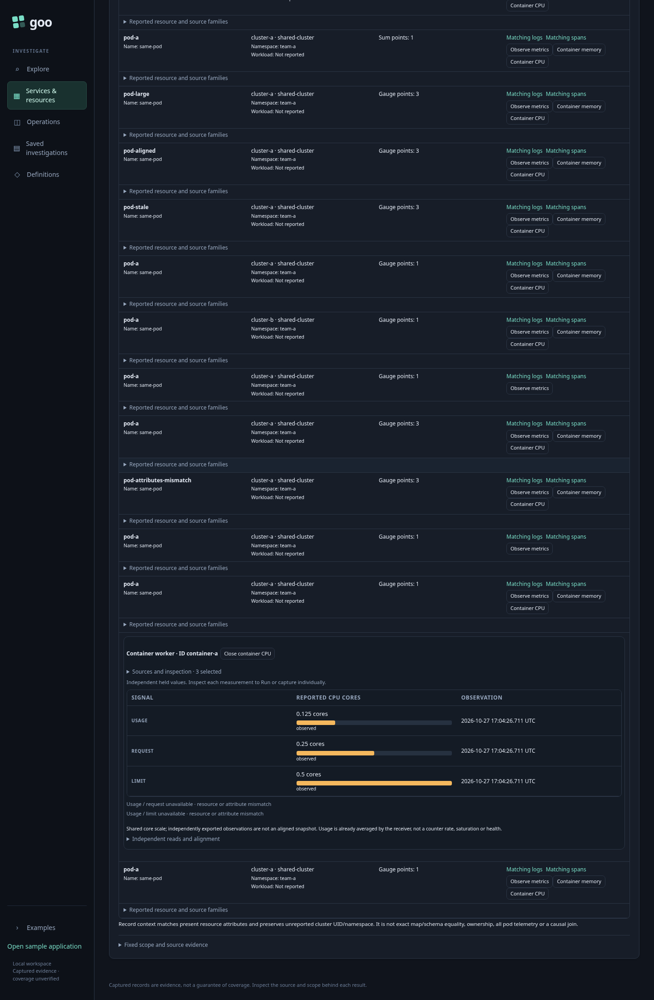
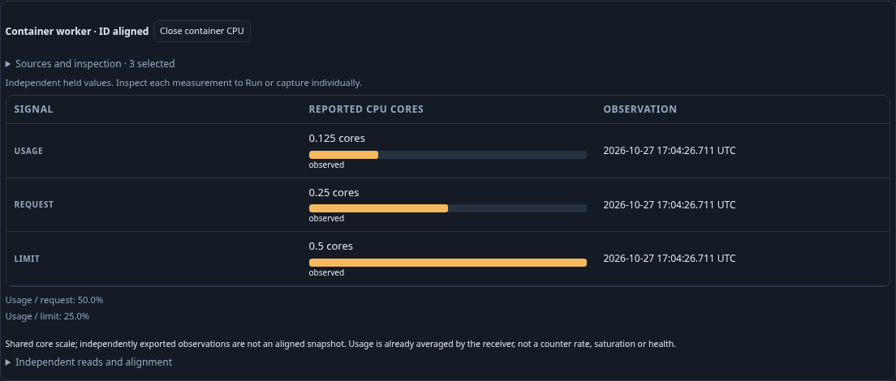

# Journey 207 — explicit container CPU context

Status: accepted with source/property/API, ordinary OTLP/browser, ownership,
Bombadil, independent raw/custody evidence and reviewed desktop/mobile frames.
[Contract and process diagram](../docs/CONTAINER_CPU.md).

1. Discover Kubernetes observations within an explicit environment and UTC
   window. Open Container CPU on an ID-bearing, known-schema resource variant.
2. Discover exact already-held variants explicitly. Preserve different receiver
   maps and schemas. Choose usage, request and limit; ambiguity needs a choice.
   Selection performs no native read and withdraws obsolete work.
3. Load selected signals explicitly, with at most three independent reads.
   Compare fractional reported cores on one zero-based scale. See each signal's
   UTC observation, quality and exact exported decimal value.
4. Receiver-realistic independent variants show values without fabricated
   percentages. An intentionally aligned report tests conditional arithmetic.
   Exercise zero denominator, missing roles, invalid domain, stale and conflicting
   observations; no older good value becomes a substitute for the latest.
5. Reopen Sources and inspection locally. Inspect one native role, explicitly
   Run and capture it, then return to the held context without rereading.
6. Reopen individual frozen evidence with no telemetry access. Check full store
   bytes and an independent raw-domain/alignment oracle with rejecting controls.
7. Exercise pending-response withdrawal and bounded Bombadil actions. Capture
   compact desktop and mobile frames from the actual app. Verify the shared
   owner still preserves existing memory behavior.

Prepared ordinary OTLP is evidence about the collector/ClickHouse/app path,
not a running Kubernetes receiver, API/RBAC or telemetry authenticity. CPU usage
is already a gauge; no CPU-time derivative or sample interval is invented.
Exact timestamp agreement permits a descriptive ratio only, never a common
measurement interval, transactional snapshot, saturation or health claim.

Actual operation counts, custody hashes, frames and limitations are recorded
below. Synthetic property fixtures are distinct from live
integration evidence.

## Source and actual browser evidence

Source milestone `eca6bf9` passes four affected Go suites, all 98 Node files,
24 Python proxy/startup tests, OpenAPI (82 Go/89 total operations, 509 schemas)
and the independent Hegel fractional-domain/alignment property (0.511s).
Focused follow-ups preserve CPU/memory accessible labels and dataset selectors.

Actual ordinary OTLP runs pass: main 50.4s, five held-response owner cases 41.2s,
and disclosure-close owner 14.1s (single-worker invocation 2.0m). The main uses
51 prepared metric points and visits the primary independent context plus nine
explicit boundaries. Other prepared profiles/time/attribute/magnitude vectors
are not overclaimed as live browser execution.

| Checkpoint | Logical source operations | Pure plans | Pure compositions |
| --- | ---: | ---: | ---: |
| Inventory | 1 | 0 | 0 |
| First exact metadata, no values | 2 | 1 | 0 |
| Second exact metadata and local selection | 3 | 2 | 0 |
| Three explicit signal reads | 6 | 2 | 1 |
| Native staging and retained Back | 6 | 3 | 1 |
| Explicit native Run | 7 | 4 | 1 |
| Fresh individual capture and return | 8 | 4 | 1 |
| Aligned context | 12 | 5 | 2 |
| Above-request and above-limit values | 16 | 6 | 3 |
| Zero denominators | 20 | 7 | 4 |
| Partial context | 22 | 8 | 5 |
| Negative domain | 26 | 9 | 6 |
| Nonbinary fractional cores | 30 | 10 | 7 |
| Stale | 34 | 11 | 8 |
| Conflict | 38 | 12 | 9 |
| Missing recorded value and frozen reopen | 42 | 13 | 10 |

These are logical HTTP effects, excluding ingestion/readiness and direct store
GET checks, not physical SQL scans or a snapshot guarantee. Primary
0.125/0.25/0.5 cores remain independent across receiver-realistic schema/map
differences. Intentionally aligned reports yield 50.0%/25.0%, and another supplied
case yields 300.0%/150.0% without health classification or clamping. Nonbinary
0.1/0.2/0.4 cores retain fractional values. Tiny/large compact formatting has
Node/property evidence, not these screenshots.

Individual capture remains 6,377 bytes, SHA256
`573b800ef141d2af4623d7926197eed574080f9a0dc3623f405c14b272140678`
through full store/public/UI reopening. Browser frozen reopen attempts no telemetry
POST; actual unavailable-source transport is separately checked by the Go HTTP
custody test. There is no paired-capture or browser ClickHouse-outage claim.

Main ledger:
`artifacts/container-cpu/container-cpu-576bd5f540/ledger.json`.
Five-owner ledger:
`artifacts/container-cpu/container-cpu-070b6fd735/ownership.json`.
Disclosure owner:
`artifacts/container-cpu/container-cpu-cbb1cf804b/disclosure-ownership.json`.
All four frames below use the main fixture and passed design review. Sources and
inspection is collapsed after load; reopening and retained Back are local.

Independent raw/custody replay and the prior memory observer regression pass;
see the final acceptance record below.

The actual Bombadil campaign passes in 31.1s (32.9s invocation), configured for
30 seconds: all 13 phases, 418 snapshots, seven source operations, three pure
plans, one composition and terminal retained Back. Receipt:
`artifacts/container-cpu/container-cpu-9971104c2f/bombadil/acceptance-summary.json`.
There was no failed browser invocation or product correction after deployment.

## Final independent acceptance

The first released native gate passes in 5.710s: CPU main 3.36s, owner 0.17s
and disclosure 0.06s reject 18 + 6 + 4 changed controls. The shared independent
raw-gauge verifier helper also passes the prior 206 memory observed regression
(1.89s/0.16s/0.05s). No production evaluator/composer is used as the oracle, and
no observer correction or repeated semantic campaign was needed.
Stdout: `artifacts/container-cpu/native-validation.txt`. The actual snapshot
oracle covers short canonical decimals; longer canonical outputs have pure
property coverage. No new Quint model is claimed for the unchanged bounded
explicit-read and retained-owner protocol.

Individual capture ID:
`71ce83c995e51b591967a6ab22eb27a15572624af200f1ff606dcd06c7ada646`.
All source/lifecycle/visual and raw-evidence checks pass. Exact temporary task
binary/helpers/tar are removed, with zero recordings eligible for ordinary
retention cleanup. Traffic, data and existing history remain intact.
