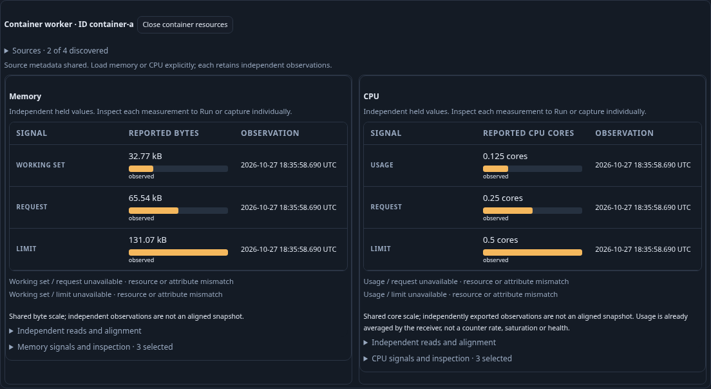
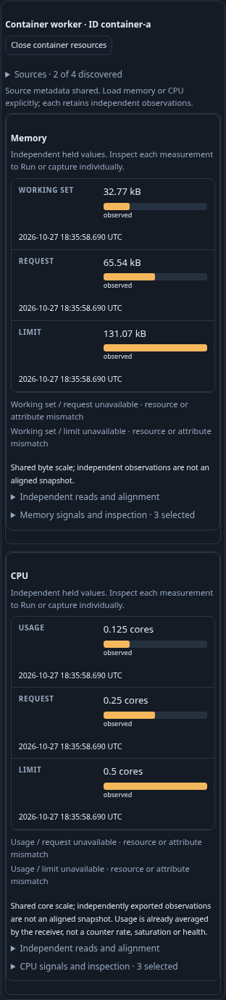
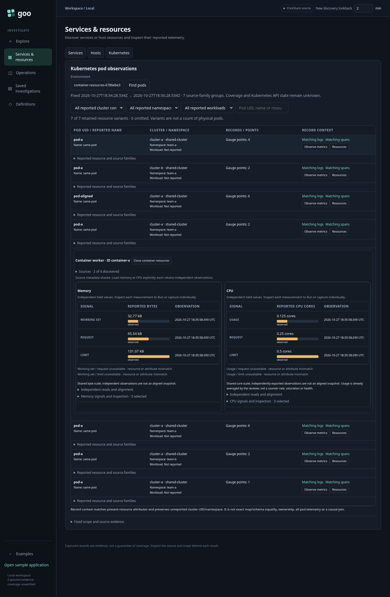
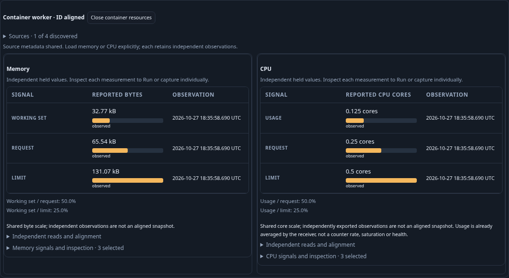

# Journey 208 — one container Resources workspace

Status: accepted with source/API/property, current browser/owner/Bombadil,
independent raw/custody, bounded Quint traces and reviewed final frames.
[Contract and process diagram](../docs/CONTAINER_RESOURCES.md).

1. Discover Kubernetes observations in an explicit environment and UTC window.
   Open Resources on an ID-bearing, known-schema resource variant.
2. Discover a second compatible exact variant explicitly. Verify the same two
   metadata responses populate both memory and CPU role choices without native
   value reads or an automatic scan of other inventory rows.
3. Load memory explicitly, then CPU explicitly. Both show their own units,
   shared family scales, UTC observations and quality. Loading CPU leaves the
   memory evidence and its read clocks unchanged.
4. Reopen setup locally; preserve deliberate choices/skips and distinguish the
   next source-discovery context from the sources behind already-held values.
   Edit one family's roles and verify only that family is cleared. Reload it
   explicitly without rereading the other family.
5. Inspect a chosen individual source, Run/capture through the existing owner,
   then return to both retained panels with no rediscovery or telemetry reread.
6. Exercise aligned and receiver-realistic mismatched observations, unknowns
   and invalid domains through the unchanged CPU/memory composition contracts.
7. Hold actual metadata/measurement/composition replies, withdraw their owners,
   then release them. Prove no late publication or cross-family contamination.
8. Reopen individual frozen evidence with no telemetry reads. Independently
   verify original raw values, alignment decisions and full stored bytes.
9. Run bounded Bombadil exploration and capture reviewed desktop/mobile frames.
   Preserve historical 206/207 frames as evidence of their executed versions.

Prepared ordinary OTLP exercises the collector/ClickHouse/app path, not a running
Kubernetes receiver or cluster. No atomic six-signal read, common measurement
interval, workload total or combined capture is inferred. Actual checks, source
budgets, artifact paths and hashes are recorded below.

## Source checks and actual workflow

Source `1901964` passes the four affected Go suites, 24 frozen HTTP fixtures,
99 Node files, 24 Python proxy/startup tests and unchanged OpenAPI validation.
The prior CPU/memory Hegel and six raw/custody replays pass in 9.627s, retaining
all 54 rejecting controls after the shared Go extraction. Source reviews approve
both private kernel and selective metadata/family cancellation.

The first browser invocation was interrupted because the ownership harness tried
to change disabled absent-role selectors; two other tests did not run. This was
not an application failure. Corrected coverage uses a memory-only metadata
variant, where CPU choices actually remain unchanged; discovering new CPU roles
would legitimately change its selection. Diagnostics are retained under
`artifacts/container-resources/first-harness-diagnostics`.

The corrected main passes in 19.6s, five-case family ownership in 21.1s and actual
metadata/composition/tab withdrawal in 11.3s (serial invocation 56.5s). The fixture
contains 23 ordinary OTLP points. Two metadata responses populate both families;
explicit CPU Load preserves held memory, and explicit memory reload preserves
held CPU. Intentionally aligned reports show 50.0%/25.0% for each family;
receiver-realistic map/schema differences withhold ratios independently.

| Checkpoint | Source operations, including fresh capture | Pure plans | Pure compositions |
| --- | ---: | ---: | ---: |
| Inventory | 1 | 0 | 0 |
| First shared metadata | 2 | 1 | 0 |
| Second shared metadata | 3 | 2 | 0 |
| Explicit memory load | 6 | 2 | 1 |
| Explicit CPU load, memory retained | 9 | 2 | 2 |
| Explicit memory reload, CPU retained | 12 | 2 | 3 |
| Native stage and retained Back | 12 | 3 | 3 |
| Explicit native Run | 13 | 4 | 3 |
| Fresh individual capture | 14 | 4 | 3 |
| Aligned memory and CPU | 21 | 5 | 5 |
| Frozen reopen | 21 | 5 | 5 |

The journal has 20 direct telemetry POSTs (inventory 1, metadata 3,
measurements 16), plus one fresh individual capture POST, five pure plans and
five pure compositions. These are logical API effects, not physical SQL scans;
setup ingestion/readiness and direct store GETs are excluded. Local edits,
retained Back and frozen reopen add no telemetry reads.

Accepted semantic/custody ledger:
`artifacts/container-resources/container-resources-4f9a0df436/ledger.json`.
Family survival/cancellation:
`artifacts/container-resources/container-resources-ee69b49ff5/ownership.json`.
Metadata/composition/tab withdrawal:
`artifacts/container-resources/container-resources-5fb0c695cc/withdrawal.json`.

Individual CPU capture remains 6,407 bytes, SHA256
`17c2d718aff5053f9ad9a5c801447d87ca203db2545e678b6afcb23c902a2df4`,
ID `b7268cfe509330e635e2efc50df68a88e43a878402b2da5fc4bd5dad2034ec2a`.
Complete before/after store and public/UI reopen remain unchanged. Frozen browser
reopen attempts no telemetry POST; it is not a real ClickHouse outage. The
existing Go HTTP checks separately cover unavailable-source custody.

## Final presentation and actor

Initial actual mobile review found vertically wrapped row labels: the shared
20% heading width overrode the mobile grid's auto width. One scoped CSS override
fixes it without changing reads or semantics. Original frames are retained in
`artifacts/container-resources/first-mobile-presentation`.

A separate focused final display passes in 41.8s (46.7s invocation), using a fresh
fixture and 16 direct telemetry reads, three pure plans, four compositions and
no capture. It checks actual text Range wrapping (at most two lines and at least
60px heading width), both-width containment, UTC tooltips, fonts/two animation
frames and source-free resizing. All four final frames below belong to this
fresh display fixture, not the earlier semantic/custody receipt. Design review
approves desktop, mobile, contextual and aligned views.

Final display:
`artifacts/container-resources/container-resources-6786ebe35e/display.json`.
Final CSS SHA256:
`c456951ff831a9c8a2dac6e1f045f4e91c3a549ffa1fb901dd7bbcaea435d277`.

The final actor passes on its first invocation on the fixed CSS: configured
30-second campaign, 41.8s test / 44.2s invocation, all 11 phases (0–10), 357
snapshots and terminal Back. Final source 10 / metadata 2 / pure plans 3 /
compositions 2. Receipt:
`artifacts/container-resources/container-resources-b301bd7c8d/bombadil/acceptance-summary.json`.

Independent 208 raw/custody and observed-protocol validation passes, as recorded
below. Historical standalone 206/207 entrance specs remain explicit skips;
their active native/API/property/raw contracts and preserved frames are not
substituted for this current shared-entrance acceptance.

## Final independent validation

The first raw gate passes main 3.33s, family ownership 0.34s and withdrawal 0.09s,
rejecting 22 changed controls. Complete store bytes/content ID, raw unit/domain
proof, selected candidate keys, family-specific endpoint provenance, both
retention directions and actual late replies are checked independently.

The initial combined gate stopped before model evaluation because Node could
not resolve a sibling dependency in the relocated node_modules directory. An
isolated Quint 0.32.0 launcher sets NODE_PATH for that CLI only; no package
installation or project dependency change was required. Typecheck then exposed
a missing explicit bool return annotation on the model's typed helper. That
annotation was corrected before judging any trace. Both diagnostics are retained.
Only the Quint test was rerun; the three successful raw gates were not repeated.

Quint passes in 37.441s: nine actual-ledger traces (main, five selective owners,
three withdrawals) and four deliberately bad model traces. The latter reject
extra reads, invalid ordering, canceled siblings and uncleared affected work.
The model is a bounded macrostep contract, not arbitrary concurrency or whole-UI
proof. active/pendingMetadata are internal controls; actual endpoint-family
provenance and metadata withdrawal rely on the independent Go evidence oracle.
No duplicate generated state machine or new numeric generator is claimed.

Logs: `artifacts/container-resources/native-validation.initial-tooling.txt`,
`native-model-validation.initial-syntax.txt` and `native-model-validation.txt`
under the same artifact root. Per-trace protocol JSON/reports live beside the
accepted main ledger. The isolated launcher/runtime receipt is retained under
`/tmp/goo-quint-208`; use QUINT_BIN as documented in verification/README.md.

Exact task binaries/helpers/tars are removed. Ordinary retention dry-run found
one eligible expired bundle; no deletion was applied and retained raw bytes are
under the 512 MiB budget. Pre-existing application data, traffic configuration,
captures and history are preserved; only ordinary test telemetry was appended.
