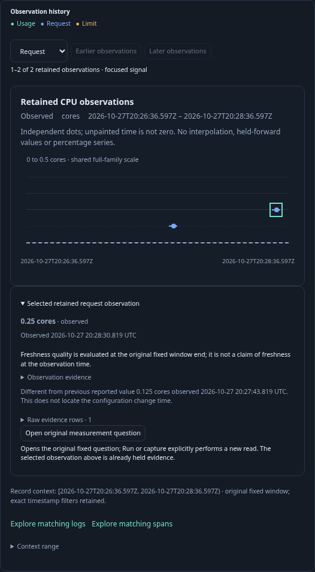
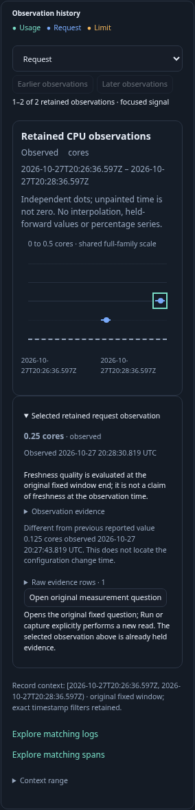
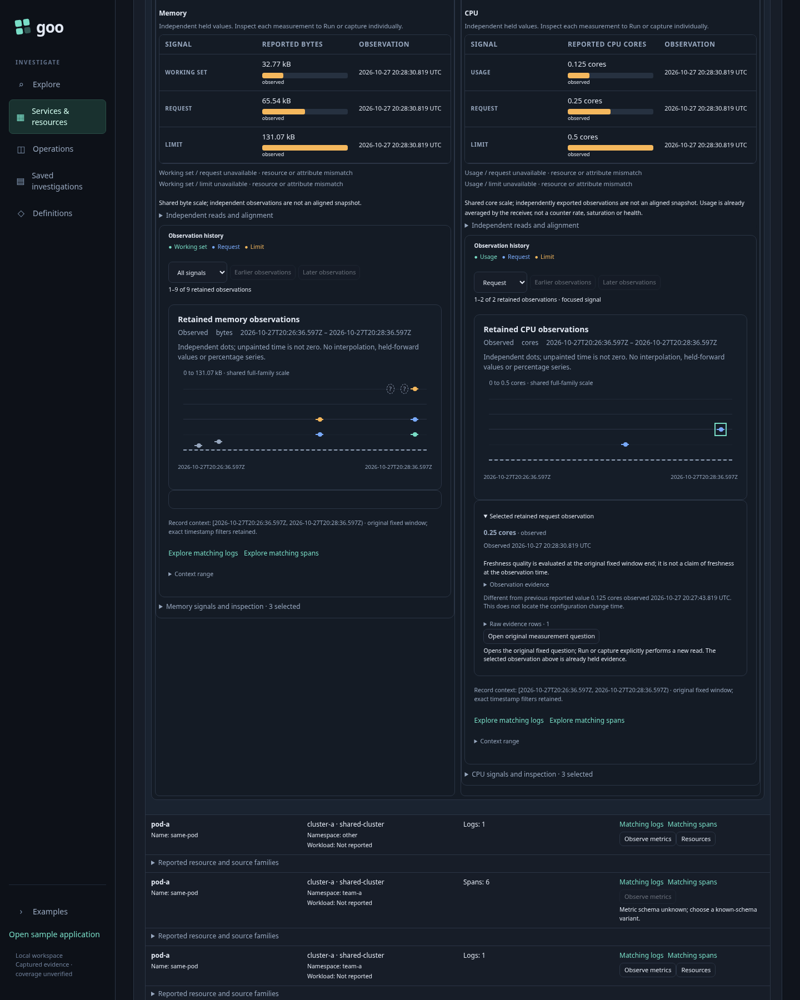

# Journey 209 — resource history and exact time context

Status: accepted with live OTLP/ClickHouse, ownership, Bombadil and independent raw/model checks.
[Contract and diagram](../docs/CONTAINER_RESOURCE_HISTORY.md).

1. Open Resources over an explicit environment and fixed UTC window. Discover
   shared source metadata, then explicitly load selected memory/CPU signals.
2. Read all three role histories on one family scale, preserving sparse
   timestamps, unknowns, invalid values and freshness as of the fixed window end.
3. Focus a role and page retained observations; confirm numeric and time scales
   remain stable, displayed counts are explicit and no source read occurs.
4. Select a point and inspect its original raw values/row indices, quality, UTC,
   read time and basis. Compare adjacent request/limit reports without inventing
   a configuration-change timestamp or interval around the point.
5. Drag a context range; repeat using keyboard/UTC controls. Verify exact
   sub-millisecond bounds, missing/empty qualifiers and end-exclusive membership.
   Opening matching logs/spans stages a question; Run reads explicitly.
6. Return to retained Resources with chart/selection intact. Capture/reopen
   individual native or record evidence through existing owners without changing
   the original held evidence.
7. Hold real pure-history replies, withdraw the affected owner and release them;
   prove no late publication and preserved unchanged sibling history.
8. Execute bounded Bombadil exploration, exact raw/custody and observed protocol
   validation, with reviewed desktop/mobile and generic-component frames.

New 209 fixtures and receipts are required: prior ignored 208 journals were
cleared by the cloud restart. Committed frames and durable captures survived.
Prepared OTLP exercises collector/ClickHouse/app integration, not running
Kubernetes receivers, configuration events, source authenticity or causality.

## Executed acceptance

The main journey passed in 14.4s with 282 metric observations and 16 context
records. Exact log/span runs each return the three expected half-open-boundary
members. Five held-history ownership cases pass (10.4s); current Resources
ownership regressions pass (15.9s and 7.0s). The bounded Bombadil actor reaches
all 15 phases and its terminal state (46 snapshots, 35.8s).

Independent raw verification rejects 17 changed controls; Quint validates six
actual finite traces / 25 macrosteps and rejects three separate bad traces.
These establish the observed protocol, not arbitrary concurrency. Two Hegel
properties exercise eight examples each. Full checks and retained diagnostic
corrections are recorded in [evidence](../docs/evidence/container-history-209.json)
and [verification](../verification/README.md).

The final compact point inspector was checked on a separate fresh fixture
(7.6s): UTC primary clocks, exact nanosecond tooltips, closed provenance, small
raw facts, desktop/mobile containment, and zero API calls for local disclosure.
The semantic main and actor passed before this presentation-only polish; they
were not repeated. These three reviewed frames show the final presentation:

The native individual capture remains 7,268 bytes with SHA-256
`6b8c87b0683aa022cf76c0dd9e42c7cab167b55b950ab23b0da315841237f15d`
after actor and display checks. History creates no combined capture format.
