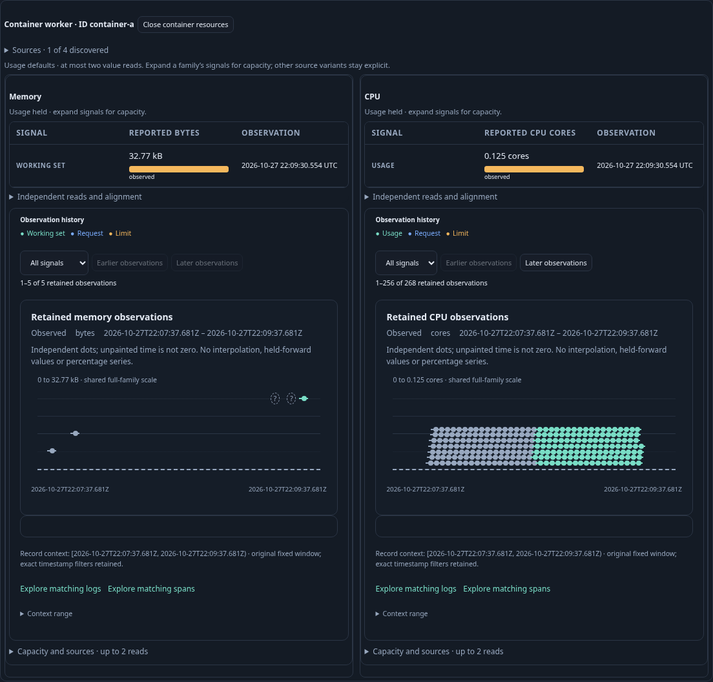
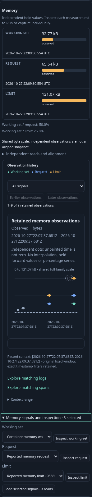

# Journey 210 — open Resources and see usage

Status: accepted. Source, live main/owners, Bombadil, Hegel and raw/Quint checks pass.
[Contract](../docs/AUTOMATIC_RESOURCE_DEFAULTS.md).

1. Discover ordinary OTel resource inventory for a fixed environment/window.
2. Open a literal container Resources row. Without source setup or Load clicks,
   see memory and CPU usage histories; the compact overview omits unrequested
   capacity rows. Initial cost: one inventory read, one metadata read and at
   most two usage reads, plus pure plans/compositions/histories.
3. Expand memory capacity with the keyboard. Its request/limit signals load
   while the original usage receipt and CPU history remain held. Collapse and
   reopen without new reads.
4. Inspect a point, stage matching logs and return to the exact held panel with
   focus retained. Staging/return remain source-free.
5. Open a resource with two memory usage streams and one CPU stream. CPU loads;
   memory requires an exact choice. Incomplete discovery similarly stays manual.
6. Hold real default replies: withdraw and release to prove no late history or
   stale capacity reads; open capacity while usage is pending to preserve intent
   without duplicating usage. Generated Hegel schedules exercise actual owner
   code; finite Quint replay checks observed effect budgets with negative traces.
7. Run the updated Bombadil actor through automatic usage, capacity and context
   return. Capture current desktop/mobile frames from the live app.

Prepared OTLP proves collector/ClickHouse/app integration, not deployed receiver
agents or source authenticity. No arbitrary concurrency proof is claimed.

## Actual acceptance

Final main passes in 13.3s: initial usage uses four source POSTs including
inventory and metadata, memory expansion adds two, and a second ambiguous-memory
container adds metadata plus CPU usage only. Final totals: eight source POSTs,
two pure plans, four latest compositions and four histories. These count issued
operations, not physical SQL scans. Context staging and retained Back are local.

Held-response withdrawal passes in 16.2s; deferred expansion passes in 19.5s.
Four raw/effect mutations are rejected. One Hegel property draws eight actual
owner withdrawal schedules. Quint validates one actual finite five-macrostep
trace and rejects two bad traces. The final presentation ledger is independently
raw-validated; the Quint trace uses the earlier semantically identical main run.

The updated 30-second Bombadil actor passes in 31.6s, covers phases 0–6 across
523 snapshots, and reaches its terminal state at six source POSTs and three
compositions/histories. Initial actor diagnostics exposed a harness API mistake:
browser Fetch has a boolean `ok`, while Playwright uses `ok()`. The corrected
actor passes without raising the budget or timeout. A separate route-cleanup
race in the first withdrawal harness was fixed; app assertions were unchanged.

Both final frames are reviewed and approved:

[Machine-readable evidence](../docs/evidence/resource-defaults-210.json) names
actual ledgers, logs, limits and asset/frame hashes. Historical 208/209 manual
entrance browser specs are explicit skips; their numerical/native/API/raw and
generic display contracts remain active.
