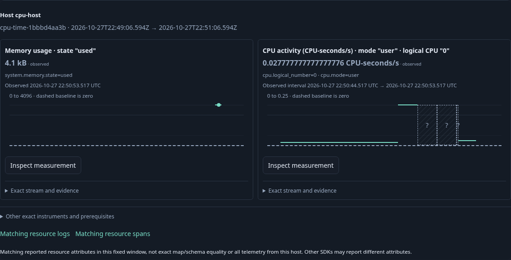
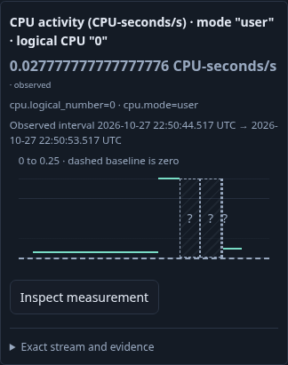
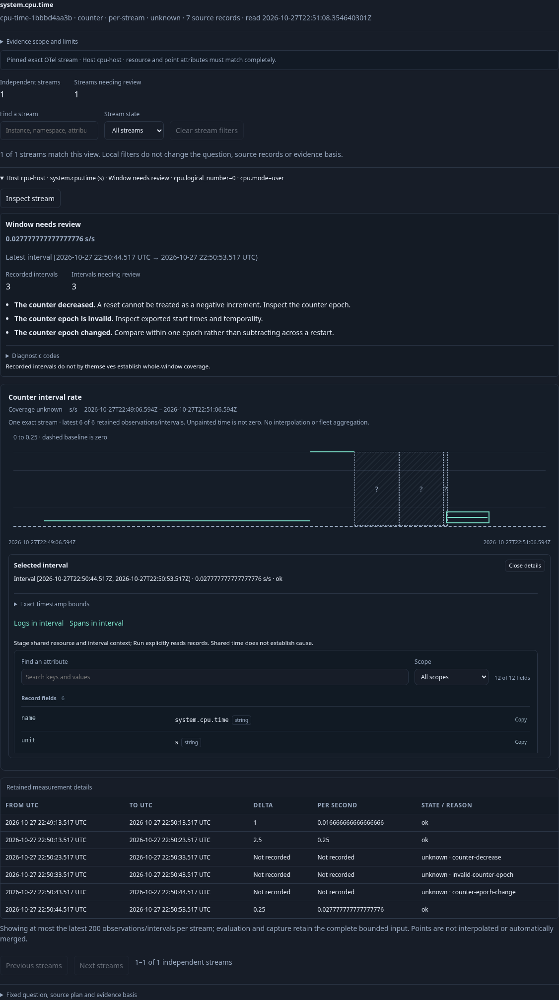

# Journey 211 — CPU activity from cumulative CPU seconds

Status: accepted with source/core/API/property, live main/owners, Bombadil and raw/Quint checks.
[Contract and diagram](../docs/CPU_TIME_RATES.md).

1. Find hosts from ordinary OTLP without service labels. Open a host reporting
   memory plus cumulative CPU time, with multiple CPU modes/cores.
2. Read memory and one deterministic CPU activity default within two native
   reads. Preserve unknown intervals through decreases, epoch changes, missing
   values and gaps; show CPU-seconds/s rather than a saturation percentage.
3. Inspect the original native question and explicitly Run. Select an interval,
   read UTC/exact delta/rational rate and stage logs/spans without another read.
4. Run each record question. Verify exact lower/upper boundary membership and
   host/environment scope across different SDK maps. Retained Back preserves
   the measurement, interval and opener; a trace expansion remains broader.
5. Capture native evidence using the existing fresh-read owner and reopen with
   source access blocked. Verify the complete stored bytes remain unchanged.
6. Hold real replies and withdraw the owner; exercise the new path with a bounded
   Bombadil actor. Reuse independent raw arithmetic and observed Quint replay;
   Hegel state schedules/parity cover arithmetic and interval mapping.
7. Capture and review actual desktop/mobile frames. Prepared OTLP proves the
   collector/ClickHouse/app path, not a running host scraper or source authenticity.

## Executed acceptance

Main passes in 10.1s. Initial cost is one inventory read plus two independent
native defaults; native Run, two record Runs and fresh capture bring the main to
seven source POSTs. Each exact log/span context returns only lower/inside/
before-upper records across a different SDK map. Stage and retained Back add no
reads and preserve interval/opener. Capture is 9,752 bytes with SHA-256
`e4bc3a8faec3562f25e8544bee58761e2248764ee1cf08d6d55f8f70c22627e0`;
reopen with source POSTs blocked preserves complete stored bytes.

Scope-withdrawal passes in 4.2s; separate gap/missing cases pass in 4.1s. The
first withdrawal harness incorrectly expected already-held hidden memory to be
deleted. The corrected check preserves that DOM and rejects late CPU publication
and new reads; app behavior did not change. The 30-second Bombadil actor passes
in 31.3s, reaching phases 0–7 across 512 snapshots at four source POSTs and one
host plan. All three actual frames are reviewed and approved:

Independent raw verification rejects seven changed controls (0.12s), binding all
seven primary observations, six expected interval cases, exact basis/delta/rate,
raw record timestamps/attributes/trace/span IDs and full capture bytes. Quint
validates the actual five-step browser effect trace and rejects an extra read
(4.97s). A separate actual decimal-kernel five-step epoch/gap/late-repair trace
reuses the existing counter model with an exact tenths binding and rejects a
restart-crossing rate (10.56s). The original integer helper still passes (9.71s).
Hegel properties configure eight examples each, including 20-step reused state
rules; these are bounded checks, not exhaustive concurrency proof.

A final cumulative-only admission guard refuses a later delta export for this
pinned host profile; generic decimal delta intervals remain supported separately.
Final measurement/mux tests and nine HTTP observations pass. The final deployed
binary reexecutes one original fixed question against ClickHouse and produces
identical raw rows and counter results. Browser/model campaigns and these frames
precede that refusal-only guard; they were not repeated. Full receipts and exact
binary/frame hashes are in [evidence](../docs/evidence/cpu-time-211.json).
