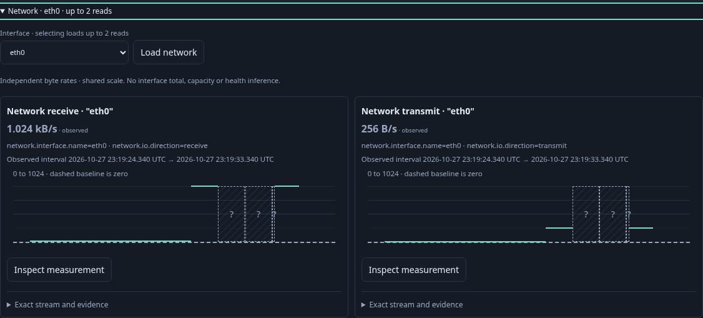
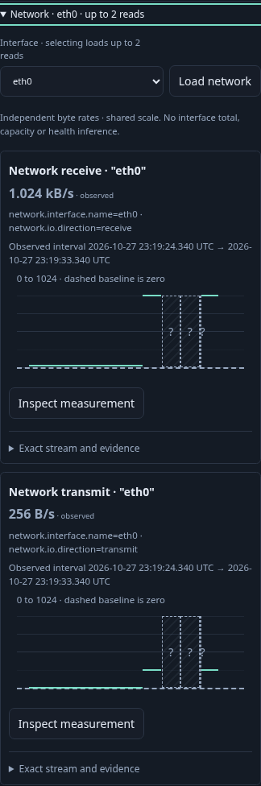
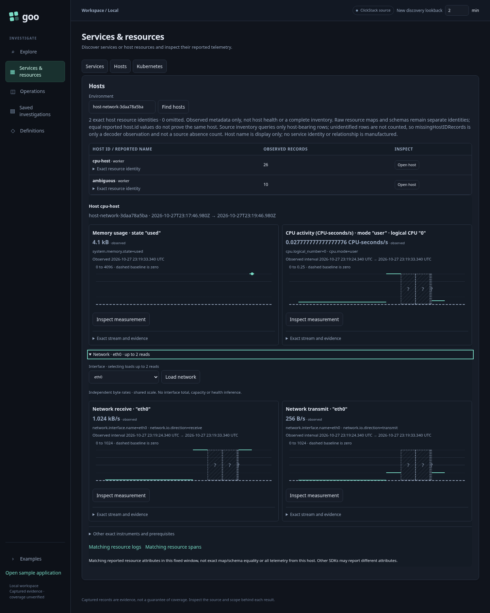

# Journey 212 — host network throughput

Status: accepted with source/API/property, live main/owners, actor and raw/Quint checks.
[Contract and diagram](../docs/HOST_NETWORK_THROUGHPUT.md).

1. Discover ordinary host telemetry; open a host and see the unchanged two
   CPU/memory defaults. Network metadata creates no automatic value reads.
2. Expand Network. A single exact interface loads receive/transmit once, using a
   common scale without summing independent streams. Inspect reset/epoch unknowns.
3. Collapse/reopen locally. On mobile, read byte-rate labels and UTC intervals
   with contained controls. Multiple interfaces and ambiguous directions stay
   deliberate; incomplete discovery remains explicit native Preview/Run.
4. Inspect receive, explicitly Run, then select the exact interval for matching
   logs and spans. Verify three boundary records across a different SDK map;
   staging/retained Back preserve selection/opener without source reads.
5. Capture fresh native evidence, reopen with source POSTs blocked and compare
   complete stored bytes. Hold real replies and withdraw the network owner;
   prove CPU/memory remain unchanged and no late network publication occurs.
6. Exercise the actor and independent raw/Quint checks. Generated Hegel byte-bound
   cases and actual-owner schedules complement live source/browser evidence.
   Prepared OTLP is not a deployed host scraper or source-authenticity proof.

## Actual acceptance

The live main passes in 24.1s. Inventory plus CPU/memory defaults uses three source
POSTs; expanding Network adds two. Reopening is local. Explicit native Run,
log/span Runs and fresh capture bring the main to nine source POSTs; this counts
issued operations, not physical SQL scans. Receive/transmit share a 0–1024 By/s
scale and show 1.024 kB/s versus 256 B/s. Both exact record questions return the
three expected boundary members across a different SDK map.

Closing two held real replies passes in 8.9s, with no late network publication
and unchanged CPU/memory. The multiple-interface/duplicate-receive case passes
in 15.7s: no choice is guessed, exact Preview/Run works, and retained Back adds no
read. The 30-second actor passes in 31.9s, visiting phases 0–8 across 282
snapshots and terminating at six source POSTs and one host plan.

Independent raw checks pass in 0.10s and reject seven changed controls. Shared
raw helpers also validate the prior CPU ledger (0.09s). Actual source rows,
outer/kernel SHA bases, exact interval arithmetic, both direction plots/common
scale, record timestamps/attributes/trace/span IDs and full capture bytes are
checked without the production evaluator as a numerical oracle. Quint validates
one actual seven-step effect trace and rejects a source read on reopen (14.01s).
Hegel configures eight examples each for byte bounds and actual-owner withdrawal
schedules; deterministic unit transport is separate from the live held replies.
These are bounded observations, not arbitrary concurrency or source authenticity.

Capture remains 10,082 bytes with SHA-256
`a74c1279004cba0bbf7cf21a9d6840635486d0560e20e097206f409ab69f5270`.
Reopen with source POSTs blocked preserves complete stored bytes. All three
actual frames are reviewed and approved:

[Machine-readable evidence](../docs/evidence/host-network-212.json) names exact
receipts and limits. No generic dashboard builder, interface total or disk-I/O
profile is implied by this slice.

Final display follow-up: charts now disclose when the existing 200-point presentation cap omits observations or intervals. A focused 201-interval renderer check verifies the count, retained full result, and unchanged shared scale; both focused Node test files passed (0.311 s). This omission-only branch was added after the successful live campaigns; those campaigns and their screenshots were not rerun.
