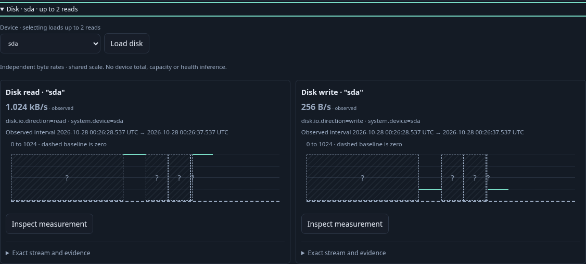
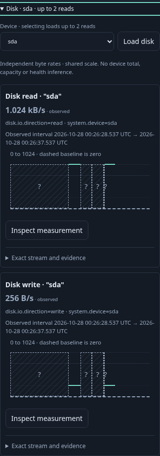
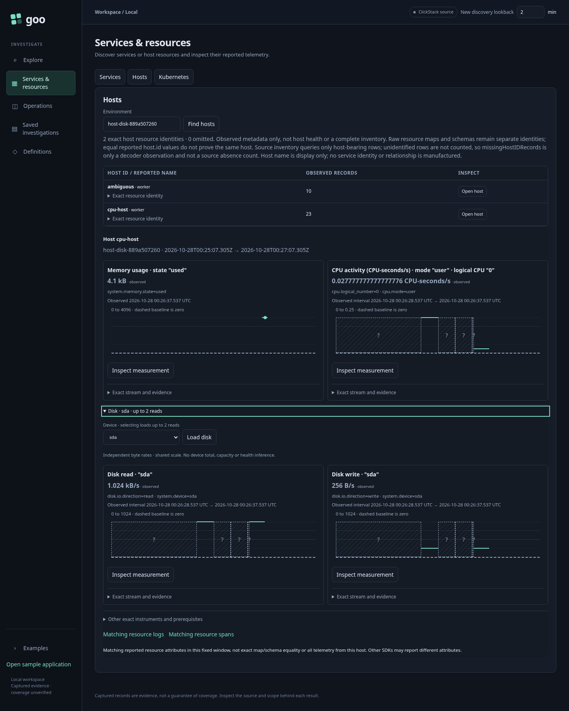

# 213 — Per-device disk throughput

Accepted with real OTLP/ClickHouse execution and reviewed final frames.

1. Find hosts in a fixed environment/window. Opening a host retains its two
   CPU/memory defaults; Disk is collapsed and performs no reads.
2. Expand Disk. With one device, load at most one exact read/write stream each.
   Compare compact B/s values on a shared scale, with resets/gaps left unknown.
3. Close and reopen locally without rereading. Refresh remains explicit.
4. Inspect one direction, then explicitly Run its exact native question.
5. Stage logs and spans for a held interval, then Run each contextual search.
   Verify exact lower inclusion/upper exclusion and cross-SDK host membership.
   Back restores the held native view and focus without rereading.
6. Capture the exact direction and reopen stored evidence with all source POSTs
   blocked; compare full stored bytes before/after.
7. Separate ownership journey holds both real backend replies, closes the panel,
   and verifies late results cannot publish or alter CPU/memory.
8. Separate ambiguity journey requires device choice, then local exact Preview
   for duplicate read streams; the unique write sibling remains independently usable.

The Bombadil actor exercises expansion, shared scale, local reopen, native Run,
context staging and retained Back. The main journey covers actual record Run and
capture. Independent raw and finite Quint checks are separate acceptance gates.

## Actual acceptance

The main journey passed in 35.7 s; pending-close and device/ambiguity journeys
passed in 6.4 s and 5.4 s (50.3 s batch). Main source POST counts were
3 → 5 → 5 → 6 → 7 → 8 → 9 for defaults, disk, local reopen, native, logs,
spans and capture. The shared rate scale was 0–1024 By/s, with 1.024 kB/s read
and 256 B/s write. Both contextual searches returned the three expected records.
Offline reopen issued no source POST and preserved all 9,778 stored bytes
(SHA256 910062fd1301562278ef1eaabc62081a3a0f43876ec1e506fcd42dfca602e565).

Bombadil passed in 31.3 s, phases 0–8, 503 snapshots, ending at six source
POSTs and one host plan. Independent raw evidence and seven changed negative
controls pass; Quint accepts the actual seven-step trace and rejects one added
local read. The initial raw oracle assumed an unclipped first interval; it was
corrected to derive clipping from the actual question, without changing the app.
CPU/network raw compatibility also pass. These are finite fixture/workflow checks,
not a claim of exhaustive state or interleaving coverage.

[Machine-readable evidence](../docs/evidence/host-disk-213.json).
