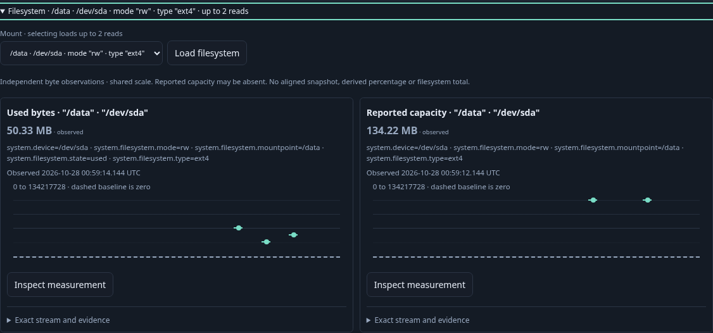
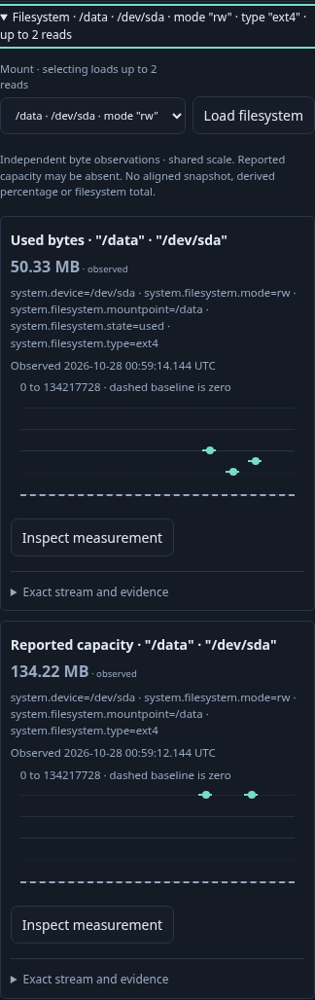
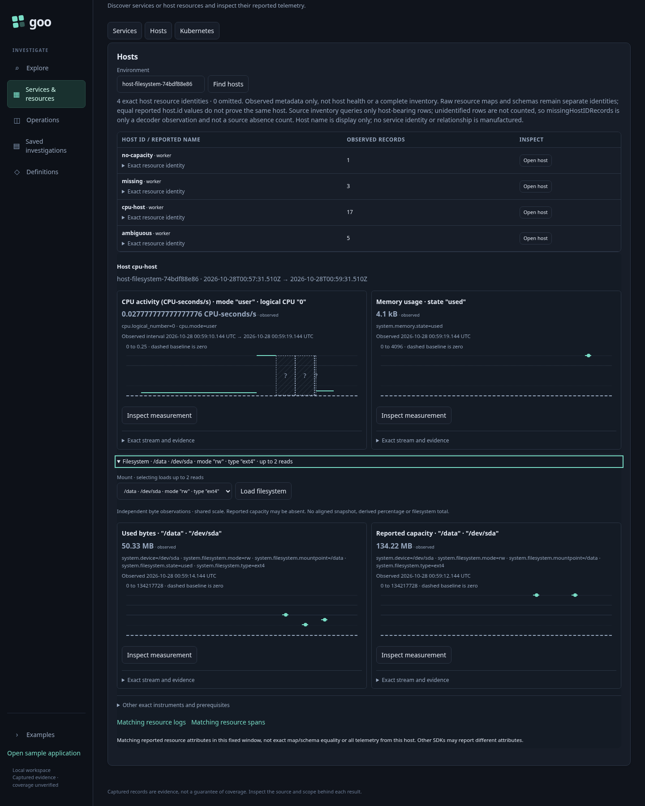

# 214 — Filesystem usage and reported capacity

Accepted with real OTLP/ClickHouse execution and three reviewed final frames.

1. Find a host in the desired environment/window. CPU/memory remain the defaults;
   Filesystem is collapsed and reads nothing.
2. Expand a single device/mount group and compare used bytes with separately
   reported capacity on a shared byte scale. Preserve their distinct observation
   times and a valid decrease in used bytes. Close/reopen locally.
3. At desktop and mobile widths, capture the actual charts and whole host context.
4. Stage existing Matching resource logs/spans links, explicitly Run each, and
   retain the host view on Back. These searches use the fixed host window and
   reported resource attributes, not stock-point or filesystem-only membership.
5. Inspect one used-byte stream, Run its exact native question, capture it, and
   reopen with all source POSTs blocked. Compare full stored bytes before/after.
6. Separate ownership case holds both real backend replies before closing,
   verifies late results cannot publish and leaves CPU/memory unchanged.
7. Separate ambiguity case chooses between mounts and previews duplicate used
   streams explicitly; the unique capacity sibling remains independently usable.
8. Separate missing-data case distinguishes latest missing used bytes, reported
   zero capacity, and absent capacity. No fallback or inferred unlimited value.

Bombadil exercises expansion, common scale, local reopen, native stock Run and
retained Back. Main Playwright executes contextual records and capture. Hegel
checks stock admission/order/decreases and generated actual-owner withdrawal
schedules. Independent raw/custody/effect and finite Quint checks are separate gates.

## Actual acceptance

Main 10.7 s, close-held 3.7 s, mount/ambiguity 7.5 s and missing/zero/absent 5.2 s
passed on the first campaign (batch 29.1 s). Main source POST counts were
3 → 5 → 5 → 6 → 7 → 8 → 9 for defaults, filesystem, local reopen, logs, spans,
native and capture. Used bytes decreased from 67,108,864 to 33,554,432 then rose
to 50,331,648; independently timed reported capacity remained 134,217,728 bytes.
Both plots shared 0–134,217,728 By. The two host-wide resource searches each
returned all five matching records. These are full host-window searches, not
filesystem or stock-point membership.

Offline reopen issued no source POST and preserved all 7,856 stored bytes
(SHA256 a1652ba0a3d956edf07587302ce17a46e972735748fe06d6e34a30b778cc6274).
Bombadil passed in 30.6 s, phases 0–7, ending with six source POSTs and one plan.
Independent raw evidence rejected 11 changed controls; Quint accepted the actual
seven-step trace and rejected an extra local read (raw 0.16 s, Quint 2.30 s,
package 2.479 s). The first observer invocation assumed an atNS chart field;
it was corrected to the existing fromNS=toNS point contract. No app change or
live rerun was required. Existing Network and Disk ownership/ambiguity browser
regressions also pass through the extended adapter. Finite workflows/fixtures
are not exhaustive state or interleaving proofs.

[Machine-readable evidence](../docs/evidence/host-filesystem-214.json).
