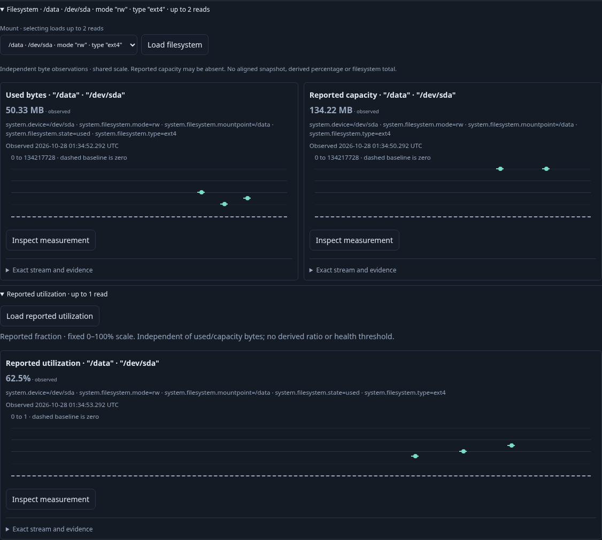
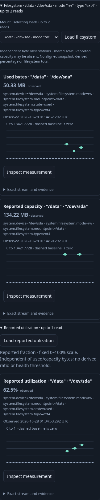
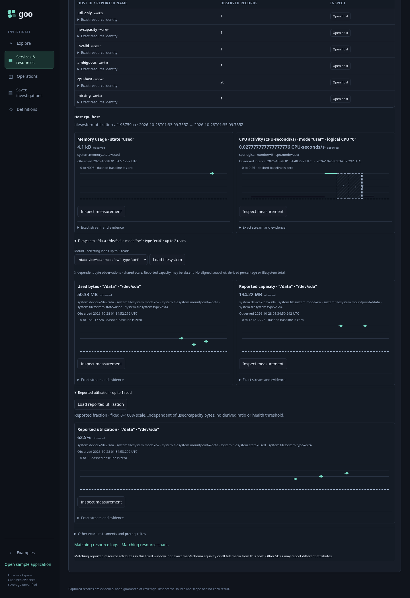

# 215 — Reported filesystem utilization

Accepted with real OTLP/ClickHouse execution and three reviewed final frames.

1. Find a host and retain its CPU/memory defaults (two value reads).
2. Expand Filesystem, adding the existing used/capacity pair only. The reported
   utilization disclosure stays closed and adds no reads.
3. Expand Reported utilization for the already selected mount. Load one exact
   gauge, render 62.5% on a fixed 0–1 domain, and retain the byte charts unchanged.
   No calculated ratio replaces this report.
4. Close/reopen child and parent locally. Capture actual desktop/mobile frames.
5. Inspect and explicitly Run the gauge, then capture it. Reopen with all source
   POSTs blocked and compare the complete stored bytes.
6. Separately hold a real gauge reply, close its parent, then verify no late
   publication and no change to accepted byte evidence.
7. Separately require manual Preview for duplicate gauges, switch mounts, clear
   old child evidence, and explicitly expand the new mount's gauge.
8. Verify missing latest values remain unavailable, invalid fractions refuse the
   whole read, and utilization-only hosts work without inferred byte capacity.

Hegel exercises original fraction admission and generated nested-owner withdrawal
schedules. The independent raw oracle reconstructs fractions, freshness, exact
stream identity, byte evidence, separate scales, capture bytes and issued POST
costs. Quint checks the actual finite effect trace and rejects a local reread.

## Actual acceptance

Main 6.9 s, parent-held cancellation 5.1 s and ambiguity/mount/state 7.1 s pass
on the first campaign (batch 22.2 s). Source POST counts are
3 → 5 → 6 → 6 → 6 → 7 → 8 for defaults, bytes, reported gauge, child local,
parent local, native and capture. The gauge reports 62.5% on a 0–1 scale; byte
charts retain their 0–134,217,728 By scale. The fixture's independently timed byte
numbers divide to 37.5%, demonstrating that they do not replace the reported gauge.
That arithmetic does not establish an eligible aligned ratio.

Offline reopen issued no source POST and preserved all 7,625 stored bytes
(SHA256 95b7ebec153a49ca575b1b0ba29233ff5545ba40504446f92cc0bd325afc33e2).
Bombadil passed in 30.6 s, phases 0–8, 642 snapshots, ending at seven source POSTs
and one plan. Independent raw checks rejected nine changed controls; Quint accepted
the actual seven-step trace and rejected an extra local read (raw 0.11 s,
Quint 2.11 s, package 2.233 s). Existing disk and filesystem byte journeys pass.
These are finite fixture/workflow checks, not exhaustive interleaving proofs.

An initial extracted test helper lacked its widget import; correcting that helper
passed focused UI and generated schedules without changing application behavior.

[Machine-readable evidence](../docs/evidence/filesystem-utilization-215.json).
