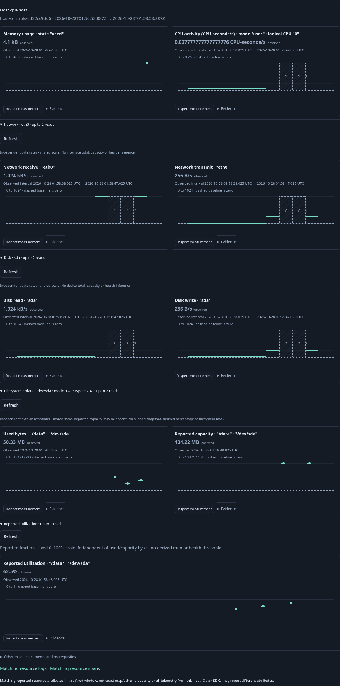
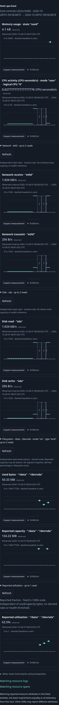
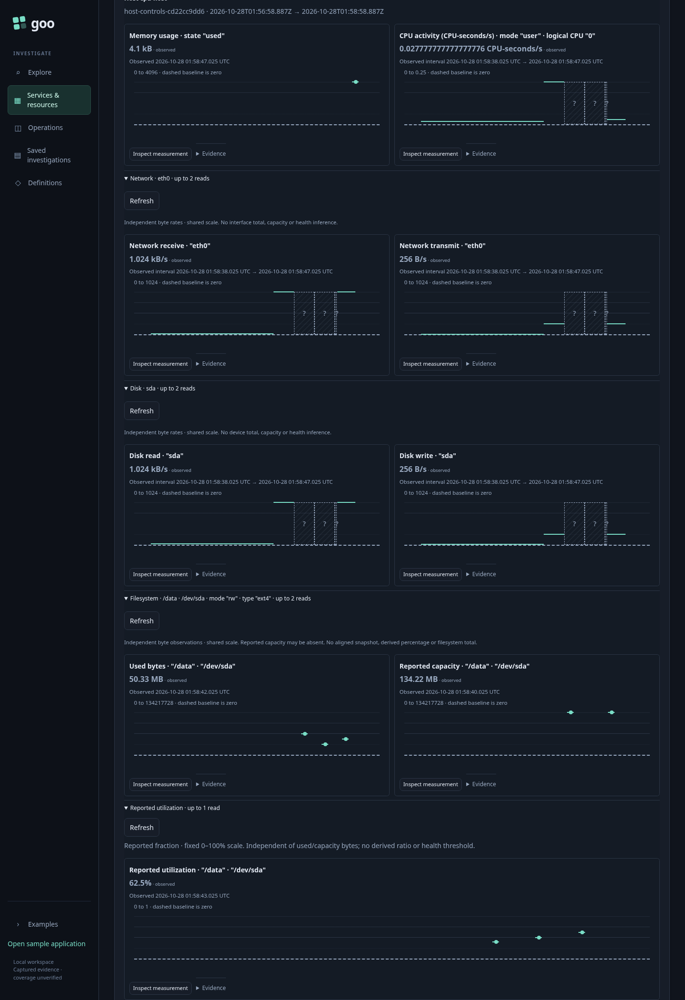
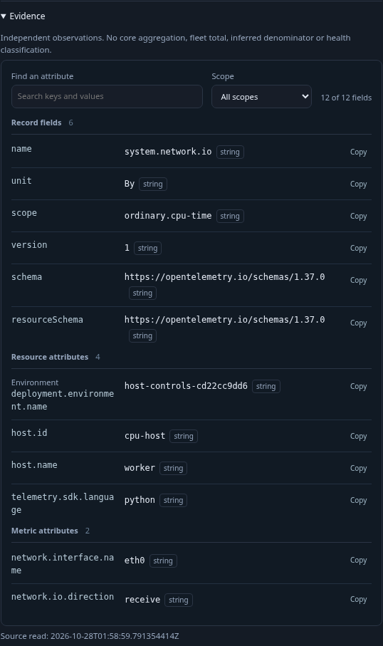

# 216 — Coherent host controls and local evidence

Accepted with actual OTLP/ClickHouse execution and four reviewed final frames.

1. Find a host with CPU/memory, network, disk, filesystem bytes and reported
   filesystem utilization. Opening it retains the two default value reads.
2. Expand Network, Disk and Filesystem explicitly. Family summaries retain exact
   selection/read budgets; complete single-choice selectors are visibly hidden.
   Each successful attempt exposes the common Refresh action.
3. Expand reported utilization for its inherited mount. Values and scale remain
   separate from byte observations.
4. Open Evidence on a network card. See the structured supplied resource/scope/
   metric attributes immediately, search/copy locally, and close it. Confirm all
   held plots and source-read count remain unchanged. Reopen family disclosures
   locally. Capture desktop, mobile, whole-page and expanded-evidence frames.
5. Explicitly Refresh Network (two reads). Inspect the utilization gauge, return
   with focus and held DOM retained, then explicitly Run it.
6. Capture the individual gauge, reopen with source POSTs blocked, and compare
   full stored bytes before/after.

The initial live check found that Evidence still required a second Inspect stream
step. Direct lazy mounting fixes that gap; the revised journey passes. It also
checks expanded evidence geometry on desktop/mobile, alongside hidden-control CSS
and source budgets. Separate existing ownership/ambiguity/unknown cases protect
manual choices and failed/canceled attempts.

Hegel exercises the actual shared owners. The independent raw oracle checks every
native response with existing profile oracles, binds nine actual plot keys to exact
plan questions, and checks every plotted value/time/state/unit/domain and full
capture. Quint validates the finite nine-step effect trace and rejects a local read.

## Actual acceptance

The revised main journey passed in 10.3 s (12.7 s invocation). Source POST counts
were 3 → 5 → 7 → 9 → 10 → 10 → 12 → 13 → 14 for defaults, network, disk,
filesystem bytes, reported gauge, local gestures, explicit network Refresh, native
and capture. Opening/searching Evidence, reopening disclosures and retained Back
added no source reads. All nine held plots stayed unchanged during local gestures.
Expanded evidence geometry passed at desktop 537/537 px client/scroll width and
mobile 302/302 px; the mobile host viewport was 324/324 px.

Offline reopen issued no source POST and preserved all 7,547 stored bytes
(SHA256 d0a24c0a1605f62a4d8c76cb7c257439c4808a461486ff4dfbdddfb144119785).
The separate Bombadil filesystem workflow passed in 30.4 s, phases 0–10,
646 snapshots, nine source POSTs and one plan. It covers local attribute search,
explicit byte Refresh, nested gauge/native Run and retained Back. Existing network
and nested-utilization ownership/ambiguity/state journeys also pass (combined
five-test batch 48.1 s).

Independent raw/plot checks reject six changed controls; Quint accepts nine actual
main steps and rejects a local reread (raw 0.18 s, Quint 2.19 s, package 2.379 s).
These checks cover this finite fixture and workflow, not arbitrary state schedules
or authentication of source data. No backend numerical or query change is made.

[Machine-readable evidence](../docs/evidence/host-controls-216.json).
