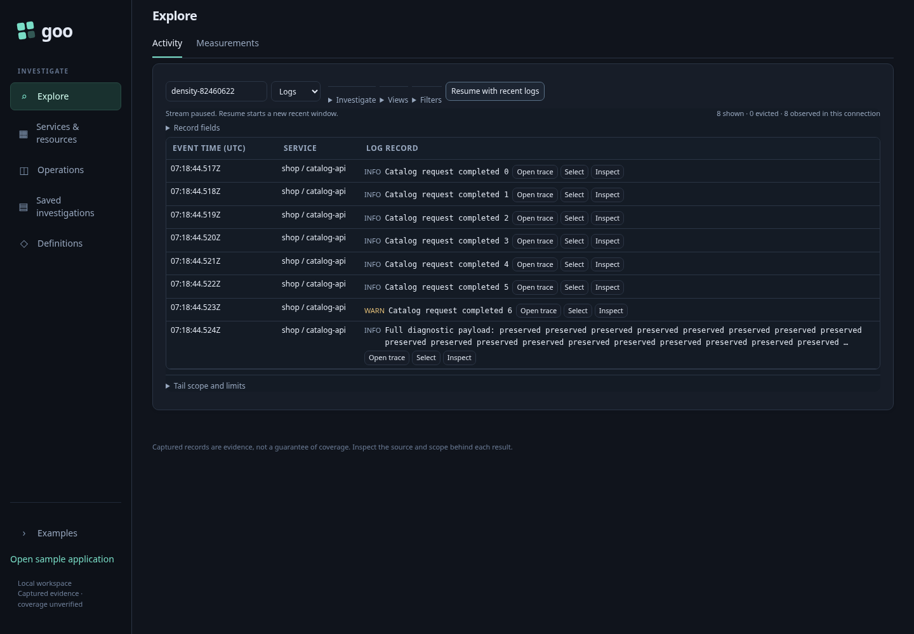
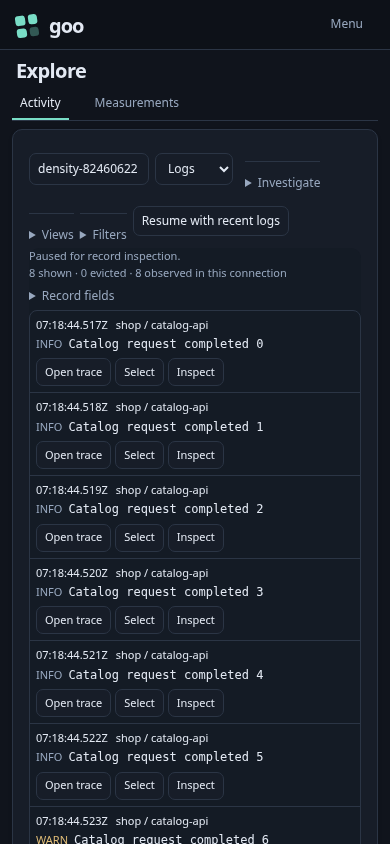
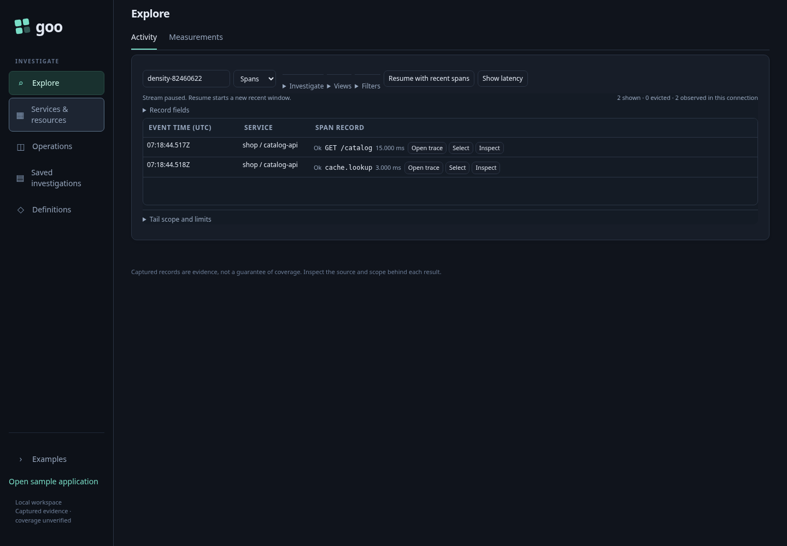
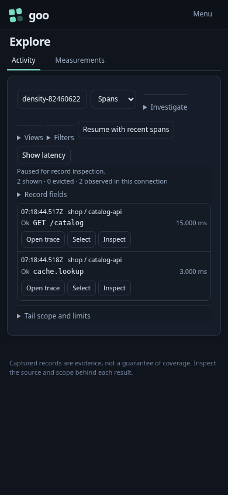

# 218 — Scan observations densely, inspect without losing detail

An engineer starts with ordinary OTel logs/spans from a catalog service. No goo
manifest is required. Short records keep severity/status, message and duration on
one desktop scan line; existing trace, selection and inspection controls remain
available. Long messages use two complete preview lines and keep the original
text in the inspector.

| User journey | Executable expectation |
| --- | --- |
| Scope Activity to the catalog service's environment | Eight real OTLP logs and two spans arrive through the collector/ClickHouse path. |
| Pause and scan the log/span rows | Short desktop rows stay below 48 pixels at 1440px; UTC time retains exact nanosecond tooltips. |
| Use a narrow viewport | 320/390/700/701px layouts do not create horizontal page overflow; mobile actions retain 28px minimum height. |
| Focus Inspect and press Enter | The held record opens without another source read; exact time is preserved and closing returns focus. |
| Inspect the long diagnostic message | The full unmodified text is available in a local disclosure; severity remains readable rather than squeezed into a vertical column. |
| Reuse the same component outside the app | Existing SSR/detached-SPA, standalone/nested and fixed-record tests retain their data/keyboard/long-value contracts. |

Run:

```sh
npx playwright test journeys/218-compact-activity.spec.js journeys/compact-record-components.spec.js --reporter=line
GOO_ENTRY_BOMBADIL=1 npx playwright test journeys/stream-entry.spec.js --grep '102 fresh' --reporter=line
```

The entry Bombadil actor now checks short-row density and pauses, inspects and
closes a held record. Existing overflow/buffer bounds and no-eager-fixed-editor
invariants remain. The 102 journey still validates its observed Quint ledger and
negative controls. The component gallery's synthetic fixtures remain explicitly
separate from this real-source product journey.

| Logs, desktop | Logs, mobile |
| --- | --- |
|  |  |

| Spans, desktop | Spans, mobile |
| --- | --- |
|  |  |

This changes passive display styling and removes duplicate app-specific message
height overrides. It adds no source read, field conversion, selection semantics,
widget state, saved format or new control bar. Full noncompact detail remains
unclamped. Chromium was checked; broader browser support is not established.
