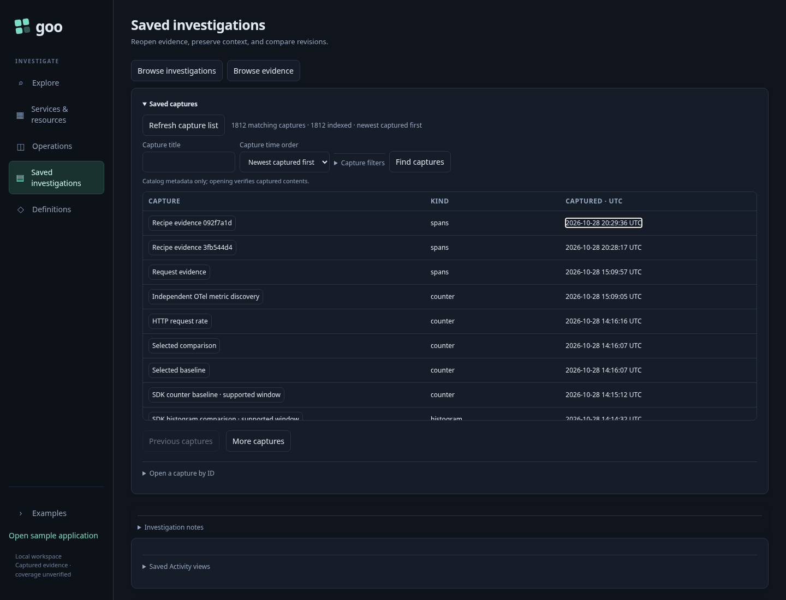
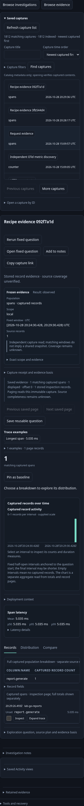

# 220 — Find stored evidence before opening tools

Current behavior note (242): the browser uses the new metadata search endpoint,
capture-time order and query-bound paging. The original ID-ordered API remains
unchanged. [Journey242](242-capture-search-storyboard.md) owns the newer search and
integrity contract; the executable 220 regression retains compact rows, UTC,
source-free paging/reopen and responsive checks.

Saved now puts its capture list before secondary notes/view/retention disclosures.
One heading and a small refresh/status row lead into the existing `goo-table`
primitive. Titles, kinds and capture times are comparable rows; manual ID recovery
stays available below the list. The store's existing order is preserved: this is
not a new recent-first sort or a cross-store search.

| User journey | Executable expectation |
| --- | --- |
| Enter Saved directly | Stored rows load without an extra navigation or refresh click; the first row is above 400px at the checked desktop size. |
| Scan capture kind/time | Human-readable UTC is shown; focusable time metadata preserves the exact original capture timestamp in its tooltip and datetime attribute. |
| Press Enter on a title | The same immutable capture opens without querying telemetry. |
| Browse more/previous captures | Row IDs/order match the server page and the selected capture stays unchanged. |
| Open manual ID tools | Existing IDs, handlers and recovery behavior remain available. |
| Switch to investigation notes and back | The existing 117 journey preserves its authored draft and pending-save/recovery behavior. |
| Use a narrow viewport | 320/390/700/701px layouts keep typed metadata within the page and retain keyboard/touch actions. |

Run:

```sh
GOO_SAVED_CATALOG_BOMBADIL=1 npx playwright test journeys/220-saved-catalog.spec.js journeys/saved-workspace.spec.js --reporter=line
```

The new stored-page Bombadil actor opens a receipt, returns to the catalog,
focuses manual recovery, and closes/reopens the list. It rejects telemetry reads,
page overflow, malformed typed rows, broken UTC metadata and uncaught exceptions.
The catalog test uses existing valid stored work; an empty clean lab receives one
explicit empty-result fixture before the source-free browser checks.





The existing store cursor, publication/retry, selected evidence and authored drafts
remain with their owners. No receipts, revisions or saved files are deleted or
merged. The shared `.capture-card` styling remains for the separate retry-recovery
surface. Definitions family discovery and whole-app mobile chrome remain follow-ons.
