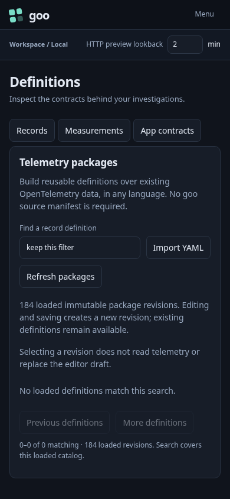
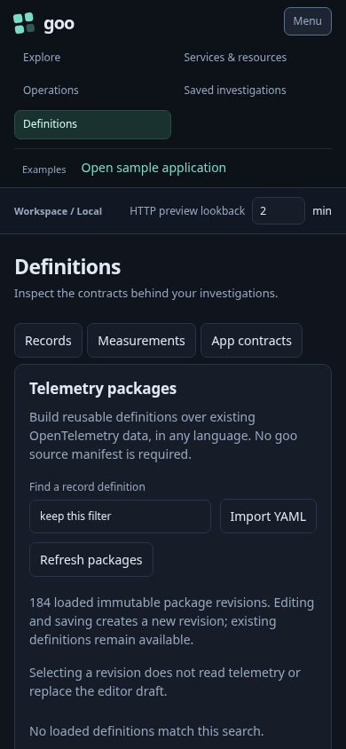

# Shared mobile navigation

A mobile investigator opens Definitions, Saved or Services directly. A compact
brand/Menu bar leaves room for the current task. Navigation belongs to the
workspace shell rather than the Activity stream's lifecycle.

1. At 320, 390 or 700 pixels wide, the menu starts collapsed. Its expansion state
   controls both the main navigation and secondary links.
2. Open Menu with a pointer or keyboard. Escape closes it and returns focus to
   the menu button. Opening/closing alone makes no API requests.
3. Choose Services, Saved, then Definitions. Each selection closes the menu,
   focuses the page heading and preserves the existing definition filter.
4. At desktop width, navigation remains visible and the mobile button disappears.
5. Activity can mount, suspend or dispose without owning or duplicating the menu.

`222-shared-mobile-navigation.spec.js` executes the layout, focus and retention
checks. The existing workspace Bombadil actor now opens the visible menu before
choosing a hidden navigation destination; its shared-state invariant runs in a
390-pixel campaign. The ordinary Activity journey remains a regression check.

