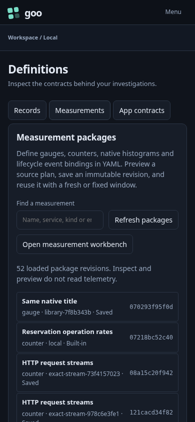

# Contextual lookback controls

An investigator browses reusable definitions without a misleading HTTP time
control above the catalog. Records and Measurements hide that global default;
App contracts shows its HTTP preview lookback.

1. Open Definitions directly. Browse Records and Measurements without the HTTP
   default. These gestures do not read telemetry.
2. Select App contracts, choose seven minutes, then visit Records and Services.
   Services uses its existing discovery label and the retained default.
3. Return to App contracts and explicitly evaluate HTTP. The actual request uses
   seven minutes; opening Saved hides the default again.
4. Preview a fixed workflow question in Records. Change the HTTP default in App
   contracts, return, and preview the workflow. The submitted question retains
   its original exact fixed bounds and definition.

`223-contextual-lookback.spec.js` executes these tasks against the lab. The
updated definition-library Bombadil invariant checks that only App contracts
exposes the HTTP lookback. Existing 221 ownership/draft and 222 responsive menu
journeys remain regression checks.

This is the first R5 slice. Global defaults in other query workflows and broader
service/resource scope/return presentation still need their separate audit.
