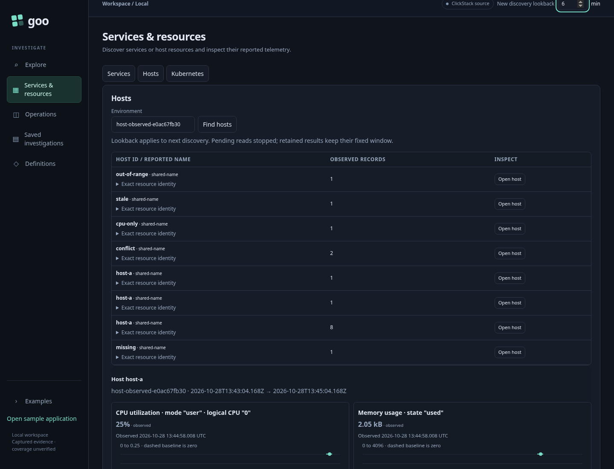
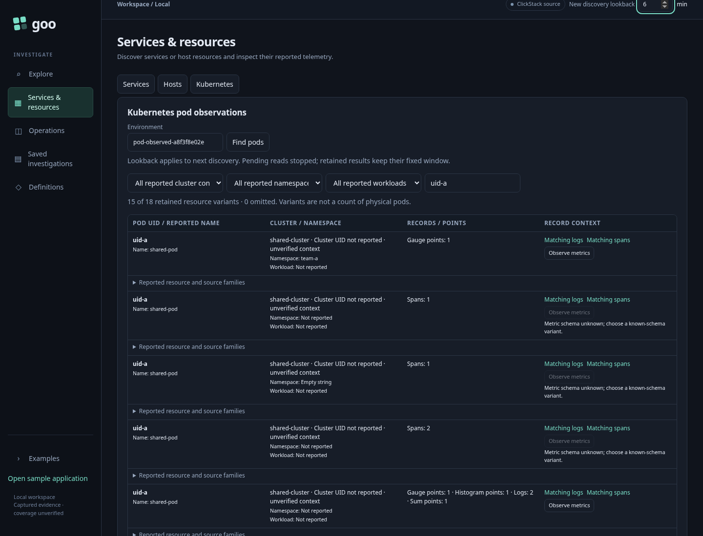

# Next discovery versus retained fixed observations

An investigator discovers a host, pod or service, opens its observations and
follows supporting records or a native measurement. The global **New discovery
lookback** is a default for the next explicit discovery. Editing it must not
silently discard the completed observations they intend to return to.

1. Discover an ordinary OTel host and open its exact-resource CPU/memory detail.
   Follow matching resource logs, change the default, and return. Original detail,
   resource predicates, fixed window and opener focus survive without a reread.
2. Discover pod variants and filter by a reported pod UID. Follow its logs, change
   the default, and return with the same row, filters, qualifiers and focus.
3. Open a service detail. Change the default in Services or App contracts. Return
   to the same completed service detail; its recorded source questions remain fixed.
4. Explicitly discover again using six minutes. The new request covers six
   minutes and replaces the prior inventory. Host/pod return controls for the
   replaced selection disappear. Changing an environment also invalidates them.
5. Hold an actual host/pod discovery response. Edit the default before it arrives.
   Cancellation targets the original query ID; releasing the response cannot
   publish late rows or start an automatic retry.

`224-retained-discovery-scope.spec.js` executes these tasks. Existing host and
Kubernetes Bombadil journeys now edit the next-read default before returning,
with the same bounded source budget. Existing ownership journeys cover departure
and environment changes. This changes application read/state ownership only;
OTel identity and measurement semantics remain unchanged.

The retained context is tab-local and is replaced by explicit discovery or an
environment edit. It is not a saved receipt or persistence guarantee.
