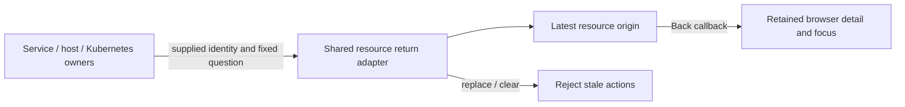

# One resource return path

An investigator follows a host, Kubernetes or service observation into Explore.
One shared application presenter shows the latest resource origin, environment,
fixed UTC window and Back action. Service names retain their namespace. Exact
nanosecond bounds remain in focusable timestamp metadata; the end is excluded.

1. Open a host and follow matching logs. The host return shows its original window.
2. Open a pod and follow its logs. The pod replaces the host return. A retained
   reference to the old host button cannot navigate or start a read.
3. Return to Kubernetes, then follow the retained host again. Editing the older
   Kubernetes environment clears only that older context, preserving the host return.
4. Follow service spans. The service replaces the host return, with a qualified
   service name and its own fixed window. At 320/390/700/1024 pixels the bar fits.
5. Return to the completed service detail without a reread. The consumed return
   is cleared. Host/pod retained observations remain owned by their browsers.

`225-resource-return.spec.js` executes this cross-resource journey using ordinary
OTLP fixtures. `resource-return.test.js` checks replacement, inactive disposal,
stale callbacks, same-owner reentry and exact nanosecond UTC metadata. Updated
host and Kubernetes Bombadil invariants allow at most one active resource origin
and require both clocks. Journey 224 continues to cover pending cancellation,
retained context and explicit rediscovery.

The adapter owns tab-local presentation and action validity. It performs no
source reads or publication. Native interval navigation retains its distinct
measurement parent chain. This is a bounded resource-origin consolidation, not
persistent browser history or a universal investigation stack.
