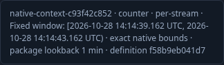
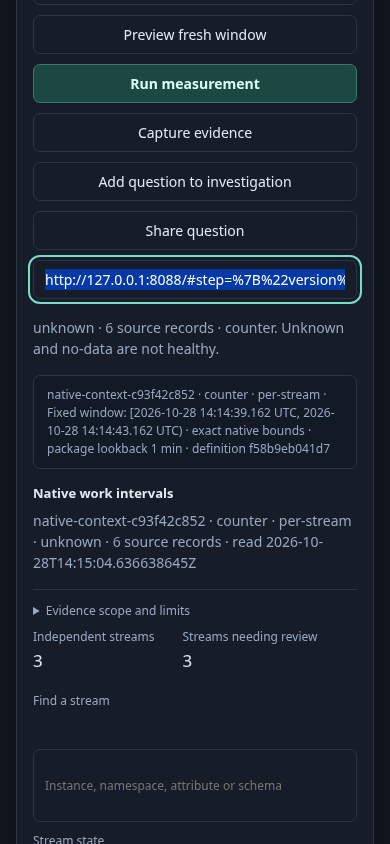

# Native measurement time controls

A native measurement owns its package lookback and fixed window. The unrelated
global record lookback is hidden in Measurements. Empty global toolbar chrome
also collapses in Saved and the Records/Measurements definition families.

1. Open an exact native question from its shared link while UI configuration is
   delayed. The selected native mode, description and hidden global lookback stay
   correct when Activity finishes mounting. No source read starts automatically.
2. Inspect two readable UTC timestamps. Focus them to see exact nanosecond metadata.
   Inline scope text retains the environment, kind, grain, binding and package
   lookback without displaying raw epoch-nanosecond numbers.
3. Visit Services, change its next-read default, and return to Measurements. UTC
   inputs and the validated exact question remain unchanged. Explicit Run submits
   the same question; Share preserves both exact bounds.
4. Preview the unchanged fixed question. It retains nanosecond precision instead
   of rebuilding the scope solely from the enclosing millisecond inputs.
5. Choose fresh preview to apply the package lookback ending now. Alternatively,
   edit the UTC inputs and preview their explicit millisecond bounds. These
   previews do not read telemetry. Tooltips describe both choices.
6. Switch to captured records to restore the retained global record default.

`226-native-scope-controls.spec.js` executes these tasks with ordinary native OTel
fixtures, including delayed configuration, exact request equality and mobile frames.
The native-context Bombadil invariant checks native ownership of the window and
the two timestamp elements. Reusable-question and supported-window journeys assert
exact metadata on reopening and retain their observed Quint validation.

UTC input editing remains millisecond precision. Unchanged validated questions,
shared links, request bodies and timestamp metadata preserve native nanoseconds.
The global lookback is retained for the other views that consume it.
