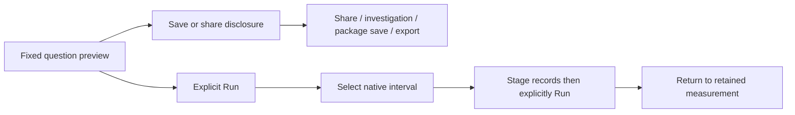
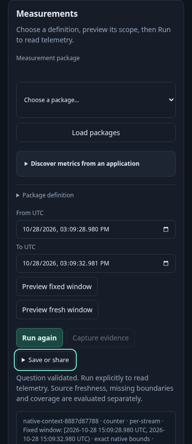
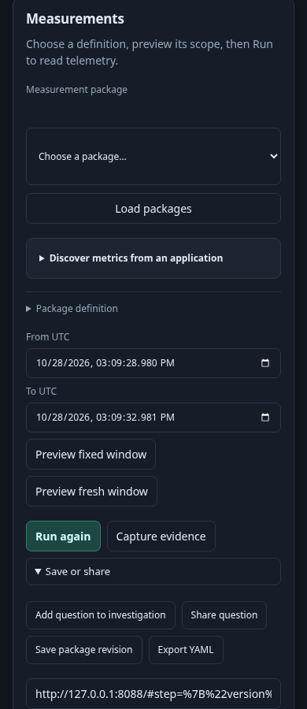

# Compact native measurement actions

An investigator opens a measurement with a fixed native interval. UTC inputs and
preview choices remain separate from execution. Run and Capture stay visible;
question reuse and definition save/export share the existing passive action
disclosure. The three introductory workflow cards are replaced by one sentence.

1. At 320, 390 and 700px, preview the fixed question. Open **Save or share** with
   the keyboard; Escape closes it and restores focus. Scope and request counts
   stay unchanged.
2. Share the question. The link remains visible outside the closed disclosure and
   preserves exact nanosecond bounds. Sharing does not run the measurement.
3. Run explicitly. Inspect one inventory stream and select a native interval.
   Follow supporting spans, Run records explicitly, then return to the retained
   measurement with its selection, exact scope and opener focus intact.
4. Capture opens the existing confirmation dialog; opening it publishes nothing.
   Edit the definition: Run, Capture and all reusable references become disabled
   until another successful preview.

The application retains source and publication ownership. The shared `UI.actions`
helper only reveals supplied controls, closes after a secondary action, and returns
focus to its summary if the invoked control still owned focus. A handler that
moves focus elsewhere keeps that focus. No new query, storage or ancestry model.

`229-native-actions.spec.js` executes this journey against ordinary OTLP telemetry
in the local lab. Existing package-discovery and investigation-step journeys now
reveal the same controls. The native Bombadil actor explores disclosure/Escape
before invalidating the definition and requires source-free preview evidence.

