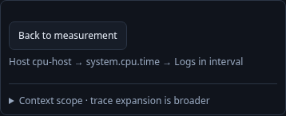

# Follow a native interval and return one level at a time

An investigator starts with ordinary OTel host observations, opens a CPU-time
measurement, then inspects logs in one exact interval. The immediate return is
**Back to measurement**. A compact path names the resource, measurement and
interval signal. The resource's Back action is temporarily hidden; its original
scope remains available under Context scope alongside the native interval.

1. Discover the reported host and inspect its native measurement. Run explicitly;
   exact CPU-seconds/rate evidence remains separate from inferred host health.
2. At 320/390/700px, follow interval logs. Staging performs no source read. One
   return strip shows `Host → measurement → Logs in interval`; hidden outer Back
   callbacks cannot navigate. Open scope details to compare both UTC windows.
3. Run records explicitly. Back to measurement restores the same result elements,
   stream selection, exact question, opener focus and resource return without a
   reread. Back to host then returns to the retained host detail and original button.
4. Choosing the native tab also consumes the interval child context and restores
   the resource return. An unrelated native question cannot borrow an older
   resource origin merely because its environment or time window looks similar.

The application passes the current resource return into the native navigator as a
bounded held presentation. It accepts only the exact opened definition and time
bounds, independent of object-key order. A revision/token guard prevents stale
restores from reviving a cleared or replaced resource. This is tab-local navigation
ancestry, not a durable citation or a claim of causation. Trace expansion remains
explicitly broader than the interval, and source/query owners stay unchanged.

`233-nested-native-return.spec.js` executes the ordinary OTLP journey. The CPU-time
Bombadil actor requires one immediate return and the host origin in interval
context. Existing 225 and 229 journeys cover standalone resource/native behavior;
unit tests cover hidden callbacks, replacement, clearing and exact-question checks.

