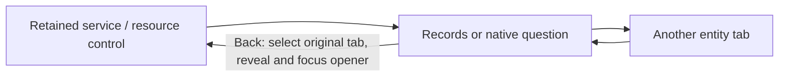
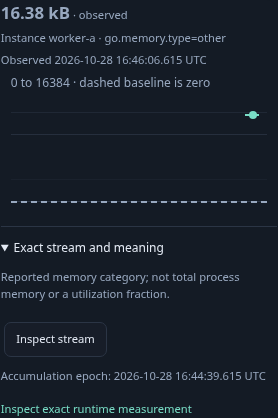
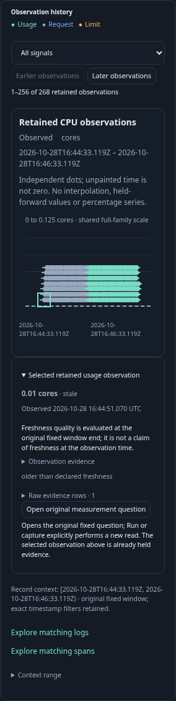

# Return to the control that started the investigation

A service or Kubernetes continuation should return to its retained entity tab and
opening control. The user can inspect another resource tab in between without
changing the original question or causing a return-time read.

1. Open a namespaced service's runtime overview. Inspect its exact native stock
   question, visit Kubernetes, and return. Back to service selects Services and
   reveals/focuses the original link in the same retained dashboard.
2. Follow service spans. This existing shortcut performs its explicit click-time
   read. Visit Hosts, then return to the original spans button with no extra read.
   The Native instruments preview button restores its own opener the same way.
3. Open Kubernetes Container Resources, select a retained CPU observation and open
   its original fixed measurement question. Visit Services, then return to the
   same Kubernetes history, selected observation and opening button. Preview and
   return perform no source reads; Run is still explicit.
4. Repeat at 320, 390 and 700px using the compact navigation menu where necessary.
   Check that the focused opener is actually in the viewport, not just focused in
   an off-screen part of a long dashboard.

The shared application resource-return helper restores visible focus, falling back
when an opener has been detached or hidden. Service callbacks now carry their
opening controls and explicitly select Services; host and Kubernetes use the same
focus helper after their existing tab-return callbacks. No component subscribes,
fetches or publishes because it receives focus. Closed/invalidated origin handling
and the immediate-parent presentation from journey 233 remain in place.

`234-service-kubernetes-return.spec.js` executes ordinary OTLP service and container
fixtures. The runtime Bombadil actor now includes a Kubernetes-tab detour and
requires Services plus the original link to regain focus within its original read
budget. The existing nested host journey checks the shared helper's host adoption.
This is not a new Kubernetes metric profile or a general browser history system.

