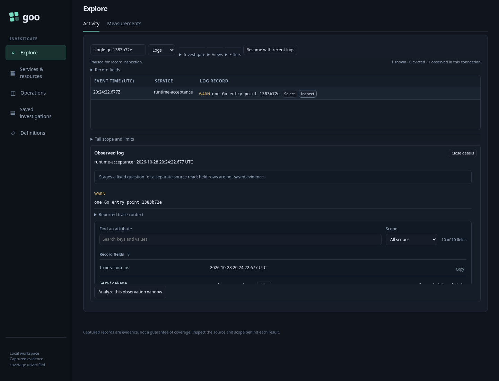

# 238 — One Go runtime, from first observation to saved evidence

The executable journey is [238-single-go-runtime.spec.js](238-single-go-runtime.spec.js).
It starts a compiled generic Go binary from an empty working directory. The only
runtime files created there are its writable evidence store; UI/API assets are
embedded. No Python frontend or HTTP proxy is launched.

1. Open the embedded UI and API docs. The runtime and UI report one generic
   profile. Native and `/api` entry points expose the same API; removed reservation
   query routes refuse rather than displaying HTML or silently returning a new
   interpretation of the old query.
2. Emit ordinary OTel logs through the real collector into ClickHouse.
   Choose the journey's environment and start Activity. Inspect a received record;
   pause and inspect stay on the held records without a hidden source read.
3. Save a fixed observation using the existing Go capture API. Reopen the exact
   saved receipt without another telemetry read. There is no identifier or stored
   evidence migration.
4. Exercise all four tail slots and abort a connection. The next tail must be
   admitted while the server remains the same single Go process. Source reads,
   cancellation and SSE flow directly through the existing handler policies.

This is a runtime-consolidation journey, not a claim of production authentication,
whole-product usability repair or complete data-source coverage. The independent
sample workloads still may use Python; Goo itself does not require it. See
[actual validation](../VALIDATION.md) for executed checks and any remaining limits.
