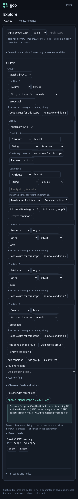

# 239 — Keep the population when switching Logs and Spans

[Executable journey](239-activity-signal-scope.spec.js) ·
[Bombadil actions/invariants](../verification/bombadil/activity-signal-scope.ts)

A user scopes Activity to an ordinary OTel service, using an attribute and a
resource field with the same key plus a nested missing-or-empty condition. They
switch Logs → Spans → Logs. Each replacement request retains the exact complete
predicate; the rows show only the selected service/population. The saved Activity
view supplies initial intent without an automatic telemetry read.

The user then edits the environment without applying it and switches signal.
Activity pauses and keeps that draft; the signal gesture cannot commit the pending
environment or start a broader read. Analyze refuses the pending scope as well.

Next they add a log-body condition, then select Spans. Activity retains all AND/OR
branches, identifies `column:body` as incompatible, opens Filters and pauses the
old stream. Apply stays unavailable until the predicate is valid. Returning to
Logs preserves the condition and still requires an explicit Apply. Invalid editor
input also survives; Activity does not fall back to the previous valid predicate.
After fixing the field, Apply starts exactly one read with the authored scope.



A transport negative control deliberately ignores abort for one real log SSE
response and delivers it after the replacement span stream is visible. The old
response cannot publish rows, change the selected signal or start another read.
The source is real OTLP/ClickHouse; only the delay/noncooperative abort is injected
in the test's browser transport.

Observed request counts are replayed through the existing Quint Activity protocol,
including rejecting mutations. The optional Bombadil campaign opens the saved
view and switches signals repeatedly; its driver checks exact outbound predicate
identity and one read per deliberate transition. Display components perform no
fetches or scope mutation. This delivery fixes signal-scope continuity; the
separate Inspect reveal/focus work remains on the roadmap.

```sh
GOO_SIGNAL_SCOPE_BOMBADIL=1 npx playwright test journeys/239-activity-signal-scope.spec.js
```

The test builds a temporary embedded Go binary unless `GOO_GENERIC_BINARY` names
an explicit one. Existing ClickHouse/OTLP fixtures and the pinned Quint toolchain
are required. It uses an isolated writable store; existing user captures are not
changed. Actual results are recorded in [VALIDATION.md](../VALIDATION.md).
