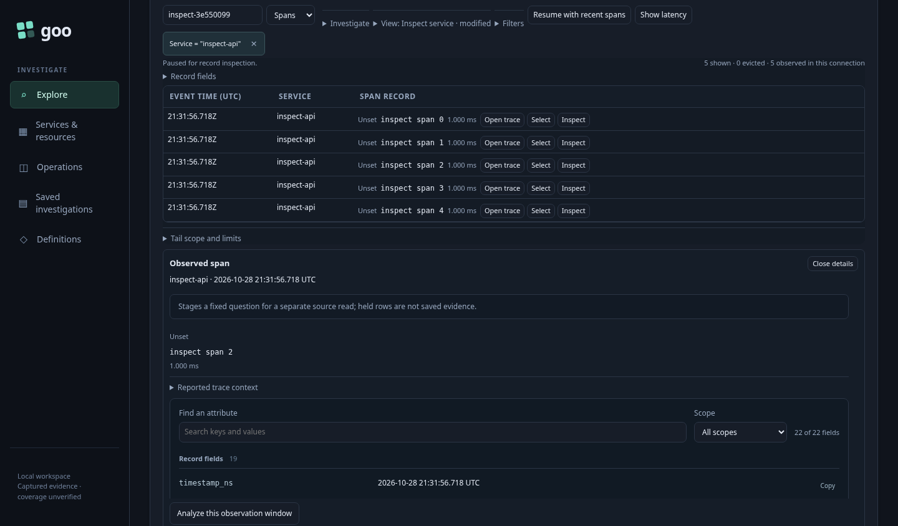
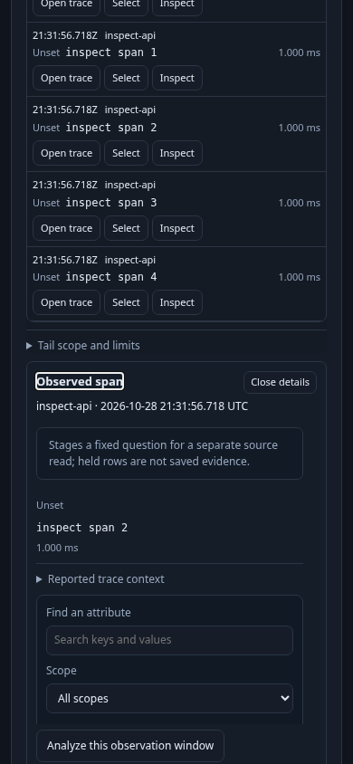

# 240 — Open an observed item, then return to it

[Executable journey](240-activity-inspect.spec.js) ·
[Bombadil actions/invariants](../verification/bombadil/inspection-return.ts)

A user opens a saved service scope over ordinary OTel logs, then switches to its
spans with the same service predicate. They choose **Inspect** on one observed
span. Activity pauses and shows the held record; the named detail heading receives
focus and the heading/Close control are brought into the viewport. No source read
or evidence publication is started by inspection.



At desktop, 320, 390 and 700 px, both pointer and keyboard opening produce the same
handoff. Tab from the heading reaches Close. Close or Escape from the heading/Close
area hides details and reveals/focuses that record's Inspect button. Its
`aria-controls` relationship names the detail region; `aria-expanded` tracks the
open state. Native inputs, selects and nested disclosures retain their own keyboard behavior; there
is no modal focus trap.



The user can stage a fixed child analysis from these held details without a read.
Returning to paused Activity restores the actual **Analyze this observation
window** action and held inspector, then closing returns to the row. Explicit
Resume clears the old details and starts a recent-window read with the existing
gap semantics.

Two boundary controls use the real captured records but inject DOM faults: removing
the opener while details are open verifies a visible environment-input fallback;
invoking detached old Inspect/facet/analysis buttons after signal replacement must
not reopen old content, pause the replacement stream or stage hidden work.
A separate supplied-data fixture checks that ordinary shared-inspector updates do
not move focus. These controls are not claims of natural eviction while a paused
stream is frozen.

The browser read-count ledger is checked against the existing Quint stream model
with rejecting mutations. The optional Bombadil campaign opens and closes two
records using Escape and Close, checking visible focus/return and one initial
stream request only. Application code owns this interaction; passive inspectors
and other display widgets do not acquire a new automatic focus policy.

```sh
GOO_INSPECT_BOMBADIL=1 npx playwright test journeys/240-activity-inspect.spec.js
```

The journey builds an isolated embedded Go runtime unless `GOO_GENERIC_BINARY`
selects one. Existing OTLP/ClickHouse fixtures and the pinned model tools are
required. See [VALIDATION.md](../VALIDATION.md) for actual executed checks.
