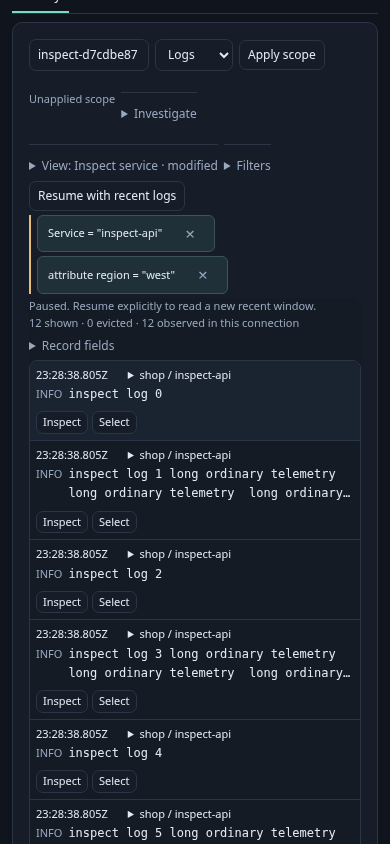
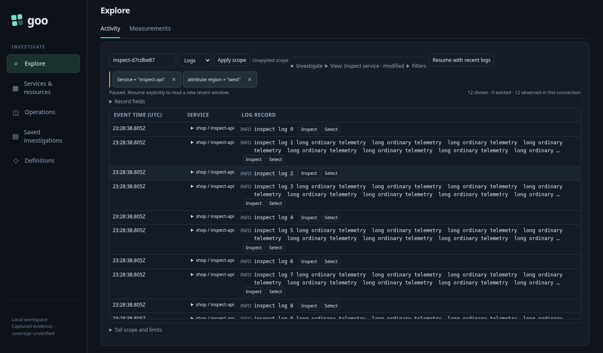

# Compact Activity scoping and actions — 241

An operator opens a saved Activity view over ordinary OTel logs, starts the stream,
and pauses on an observation. Inspect stays the first record action; selection
remains a separate pressed button, and valid trace IDs retain Open trace.

1. Read the qualified service identity. Open the service identity disclosure (accessible name **Filter service**). The
   disclosure only reveals local actions; no source read occurs.
2. Choose **Only this service** or **Only this namespace**. These stage literal
   `column:service` and `resource:service.namespace` predicates, preserving the
   existing question. Missing values offer no shortcut; an empty recorded string
   remains an exact empty string. Choose **Apply scope** to read again.
3. Focus Inspect and press Enter. In the named detail region, search for an
   attribute and use Include/Exclude. Secondary actions live in **Field actions**;
   Escape closes that disclosure and returns to its summary while keeping details
   open. Close details to return to the row.
4. Replace scope. Detached old row actions cannot inspect, select, pause, open a
   trace or stage a filter into the replacement stream. Hidden-document row
   callbacks are also inert.

The executable [journey](241-activity-actions.spec.js) injects real OTLP telemetry
and uses an isolated Go runtime against the local ClickHouse. It compares the
presentation at commit `2776bea` (required in the checkout history) with the same short/long records at
320/390/700/1440px. Only the baseline page receives the previous presentation
modules/styles; both pages read the same actual telemetry. The main page's
request-count ledger is checked with the existing Quint stream model and its
rejecting controls. This checks read ownership, not a formal model of DOM focus.
The inspection Bombadil campaign additionally reveals and stages a service filter
without a second read.

Measured pointer-view geometry (short / long row, CSS px):

| Width | Before | After | Fully visible rows before → after |
|---|---|---|---|
| 320 | 82.69 / 101.88 | 80.19 / 99.38 | 5 → 5 |
| 390 | 82.69 / 101.88 | 80.19 / 99.38 | 5 → 6 |
| 700 | 82.69 / 101.88 | 80.19 / 99.38 | 5 → 6 |
| 1440 | 36 / 74.88 | 33 / 71.88 | 8 → 9 |

The mobile sizes above are viewport checks with a mouse pointer. Coarse pointers
retain larger targets through a separate media rule; these numbers do not claim
identical touch geometry. The comparison includes the stream viewport, not an
unchanged count across the whole page. Existing toolbar cleanup is deliberately
bounded here; a global CSS rewrite is outside this cut.
