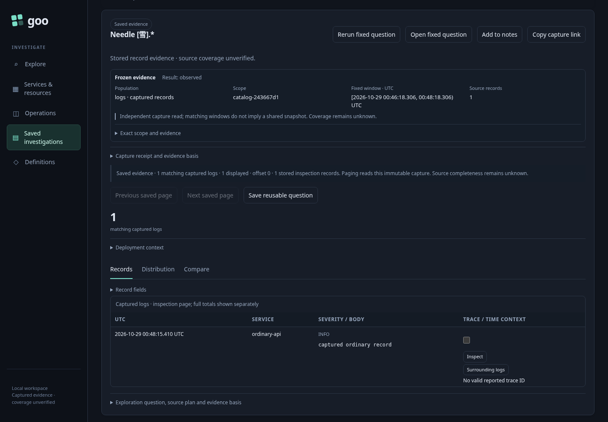
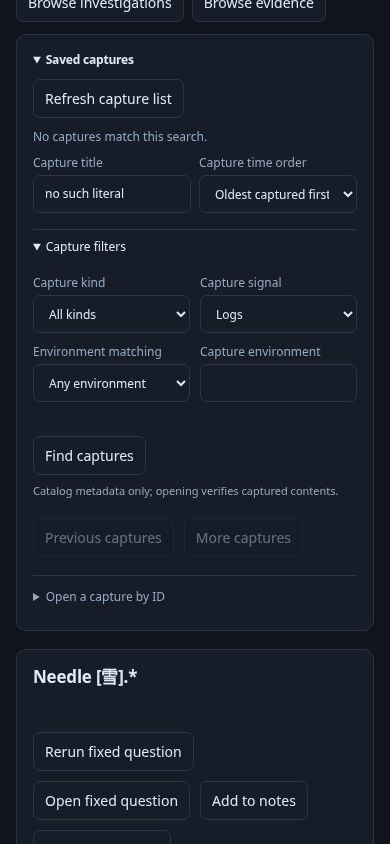

# Find saved captures by task and capture time — 242

An operator has ordinary OTel data and wants to return to evidence saved earlier.

1. Run a fixed log question and choose **Capture evidence**. Name it `Needle [雪].*`.
   This is a real bounded source capture, not a snapshot of browser DOM rows.
2. Leave the question and return to Saved → **Browse evidence**. The catalog is
   newest-captured first; this earlier capture is now beyond its first 20 results.
3. Type its literal title. No request is sent while editing. Choose **Find captures**
   with the keyboard; the result is found across the catalog, not just page one.
4. Open it. The saved receipt and contents exactly match the original; no telemetry
   query runs. Search remains a separate task from rerunning the fixed question.
5. Search two captures named `Shared title`: both remain separate immutable IDs.
   Expand **Capture filters** to choose known signal and exact environment. An
   explicit empty environment is not “any” or unknown. Oldest/newest order uses
   receipt capture time; paging is query-bound and source-free.
6. Edit again while a real previous response is delayed. Old row callbacks and the
   late response cannot replace the new scope or reopen stale selection. No-match
   state stays empty, with a clear status and the already opened evidence retained.

7. If metadata is unavailable, see an explicit error and reopen by exact ID.
   Corrupt metadata is also an error, never a false empty result. The test only
   removes/corrupts derived metadata in its owned temporary store and restores it.

The [executable journey](242-capture-search.spec.js) uses an isolated Go runtime,
real OTLP ingestion/ClickHouse, a UI save, and 27 additional real captures. It checks
320/390/700px geometry, explicit filters, global ordering/paging, same-title IDs,
unchanged receipts, stale callbacks and a real delayed response whose abort is
intentionally ignored. The Quint ledger checks save/read ownership through browse
and reopen, with three rejecting mutations; it is not a proof of the sorting or
filesystem protocol. Go tests cover those contracts. Hegel interleaves search with
capture/refresh, source changes and immutable reopen. Bombadil exercises title
search, ordering and selection without telemetry reads.

The [metadata catalog contract](../docs/CAPTURE_CATALOG_SEARCH.md) distinguishes
metadata consistency from content verification on reopen, and documents rebuild,
publication failure and scan budgets. It makes no production-scale latency or
transactional filesystem snapshot claim.
