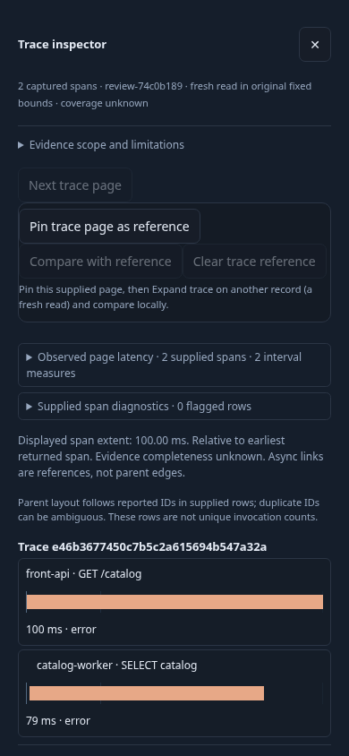
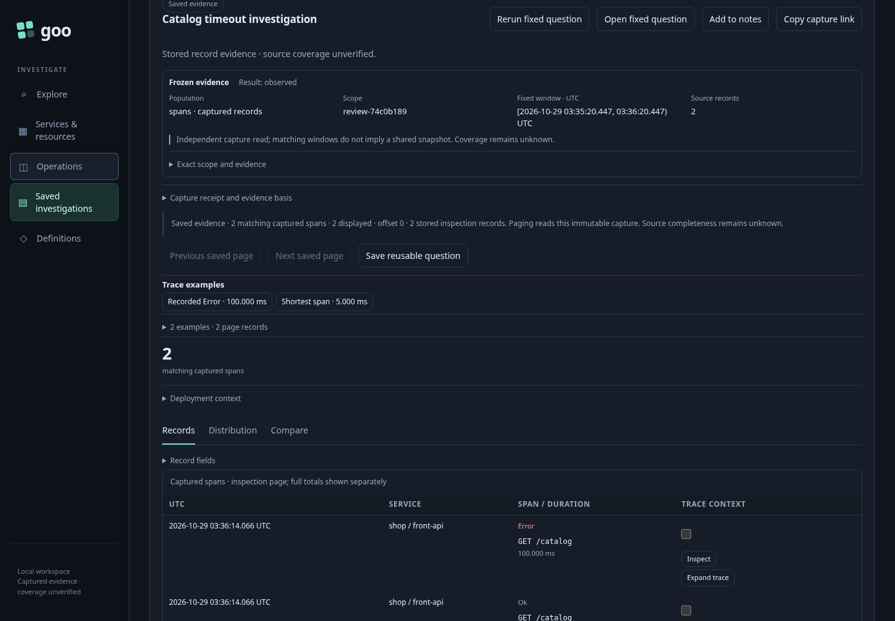
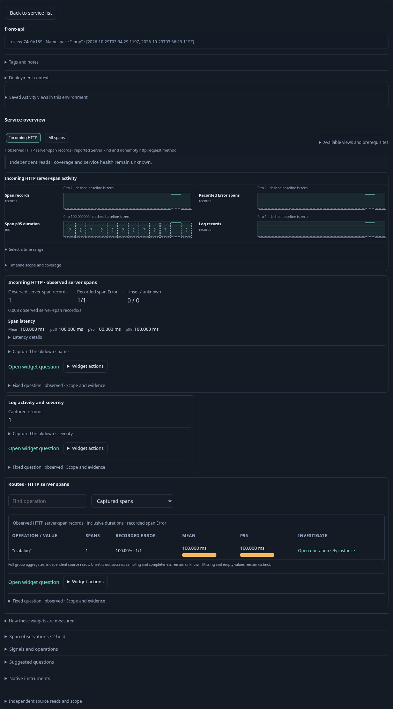

# Whole-product review task — 243

Review checkpoint, not a runtime fix. See the [six-reviewer reconciliation](../docs/reviews/INDEPENDENT_REVIEW_SUMMARY_243.md)
and [revised roadmap](../docs/ROADMAP_2026_10_29.md).

An engineer notices a request timeout in Activity, narrows to its service, switches
from logs to spans without losing the predicate, and inspects a record. Opening
the trace reveals a database-client child and a linked log across services; the
interface explicitly states that the original filters are not applied to this
supporting context. Closing the sheet and returning restores the held Activity
rows without reading telemetry again.

The engineer stages analysis of that observation window, explicitly runs it, and
captures the fixed question. This is a fresh read, not an exact bookmark of the
previous live observation. After leaving, title search finds the capture and
reopen preserves its receipt without another telemetry request. The capture saves
the scoped fixed result, not every supporting trace or log visited along the way.



At 390×844 the full-screen trace sheet covers the global Return control. Normal
Close trace → Return succeeds. Closing currently focuses `exploreRun`, and reverse
Tab from Close reaches outside the sheet. Parent-aware return/focus and keyboard
ownership need refinement; this is not a claim that all return is blocked.



The saved-evidence masthead repeats counts and custody/scope explanations before
the record table. The review proposes consolidation, preserving exact receipts.



The same owned fixture supports service discovery and an HTTP overview, followed
by Definitions and Operations walkthroughs. These are smoke observations, not
complete coverage of those surfaces or evidence of service health.

## Execution and limits

[Playwright probe](243-whole-product-loop.spec.js) runs only with `GOO_REVIEW243=1`.
It builds/starts a temporary Go runtime, uses a temporary capture store and emits
namespaced real OTLP fixtures to the existing collector/ClickHouse lab.

```sh
GOO_REVIEW243=1 GOO_REVIEW243_WORKAROUND=close-trace \
  npx playwright test journeys/243-whole-product-loop.spec.js
```

Without the workaround flag the direct global return attempt reproduces mobile
occlusion. The original `GOO_REVIEW243_CAPACITY=1` probe observed 257 accepted definitions
and a failed catalog at checkpoint 243. After correction 246, this optional branch
asserts the current 256 accepted / next refused / catalog readable policy. The
[dedicated journey](246-native-catalog-capacity-storyboard.md) now owns capacity
and exact revision recovery acceptance. `GOO_GENERIC_BINARY` can select a prebuilt binary.

Final run passed in 17.0s (19.7s including runner setup). Core request totals were
three tail requests, two supporting context requests, one fixed analysis request
and one capture request. Inspect, return and saved reopen added none. These count
browser requests, not internal SQL queries. No product source changes, runtime
deployment, existing evidence deletion or volume resets occurred. This probe is
not a full accessibility audit or a required browser CI tier.
