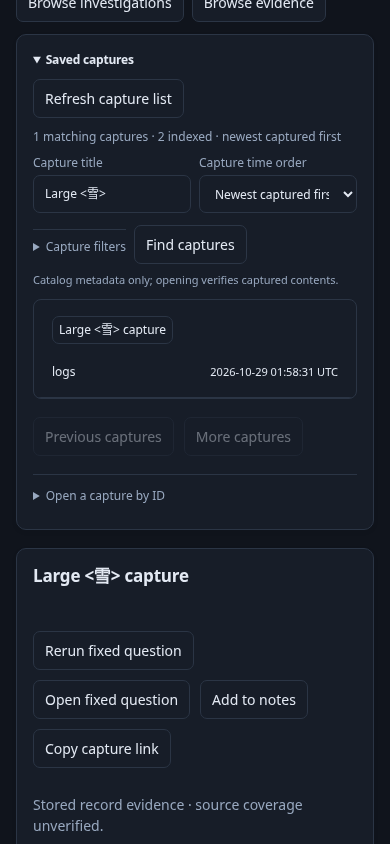

# Bounded catalog summaries and recovery — 244

An engineer saves a valid log question containing many literal service predicates.
Its escaped full receipt exceeds the old metadata-entry limit. Saving still
succeeds, and Saved → Browse evidence now lists it alongside earlier evidence.
The table receives a bounded summary, not a full question or partial receipt.
Opening the row retrieves and verifies the unchanged authoritative capture.

An administrator upgrades an existing store: search reports missing v2 metadata,
while exact-ID open continues to work. Explicit `goo rebuild-capture-catalog -dir`
verifies the capture files and writes `.catalog-v2`. Search then finds both old
and previously unindexable captures. Original payload hashes and IDs are unchanged;
old `.catalog-v1` data is left untouched. No UI action secretly rebuilds the store.



[Executable Playwright journey](244-capture-summary.spec.js) starts an isolated
Go runtime with temporary storage against the real lab ClickHouse. It saves two
fixed questions, opens the large one, removes only its owned test index, invokes
the actual rebuild CLI, checks payload hashes/old-index preservation, then searches
by a literal Unicode/HTML title at 390px. Browser browsing/opening triggers zero
POSTs and no page errors. These fixtures intentionally have no matching telemetry;
[journey 242](242-capture-search-storyboard.md) supplies real OTLP record evidence,
20-row pagination, query-bound cursors, stale responses and missing/corrupt metadata.

```sh
npx playwright test journeys/244-capture-summary.spec.js journeys/242-capture-search.spec.js
```

Actual-handler Go regression also crosses HTTP admission, successful immutable
save, summary discovery and repair. Public-Go tests cover large native definitions
and paired questions. Hegel varies valid escaped/non-ASCII strings and predicates
across accepted creation → search → rebuild → unchanged bytes; the existing
capture state/swarm interleaves source arrivals, saves, refresh and paging.
Existing Quint browser-ledger negative controls and optional Bombadil catalog
actions remain attached to journey 242. This cut does not claim campaign-completion
proof or a new Bombadil campaign. Source/admission limits and metadata write
failures remain explicit; the whole-store 256 MiB rebuild ceiling is unchanged.
