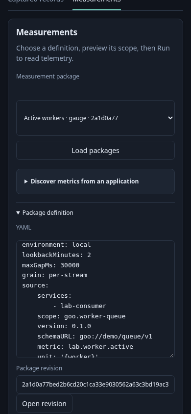

# Native catalog capacity and revision recovery — 246

A team saves reusable native definitions. The first 256 distinct revisions are
accepted; the next save explains that capacity is reached. The complete catalog
still loads, and retrying an existing revision succeeds without another file.

A legacy/external writer previously left the directory over its limit. Refresh
reports the problem while retaining the loaded rows and selected detail. An
engineer opens the measurement workbench, expands Package definition, enters a
known revision and chooses Open revision. Exact lookup verifies that immutable
file and previews the question without running telemetry. Existing bytes remain
unchanged. Full catalog refusal remains visible; exact recovery does not pretend
to repair the whole store.



[Playwright](246-native-catalog-capacity.spec.js) starts an isolated Go runtime and
publishes 256 definitions through the actual endpoint, checks refusal/duplicate/
full browse, then adds one owned legacy alias to reproduce an over-limit store.
The UI restores the known definition with no measurement, discovery, log or span
reads, no page errors and no overflow at 390px. All stores and added alias bytes
are temporary; the live lab's definitions/evidence are not altered by this task.

```sh
GOO_NATIVE_CATALOG_BOMBADIL=1 \
 npx playwright test journeys/246-native-catalog-capacity.spec.js
```

The actual boundary observations 255 → 256 → refused/256 → duplicate/256 are
replayed through [Quint](../verification/model/native_catalog.qnt). Three changed
controls are rejected. This is prefix safety, not a campaign-completion verdict.
The updated source-free Bombadil actor independently observes validated preview
before proceeding through exact revision opening and invalid authoring; it retains
its no-evidence and capture-disabled invariants. Hegel state/swarm interleaves
publication, duplicate, lookup and whole-catalog membership near capacity.

This cut does not add paged catalog discovery or automatically repair/delete an
over-limit store. See the [capacity contract](../docs/NATIVE_CATALOG_CAPACITY.md)
for builtin aliases, physical limits, platform/locking and recovery boundaries.
