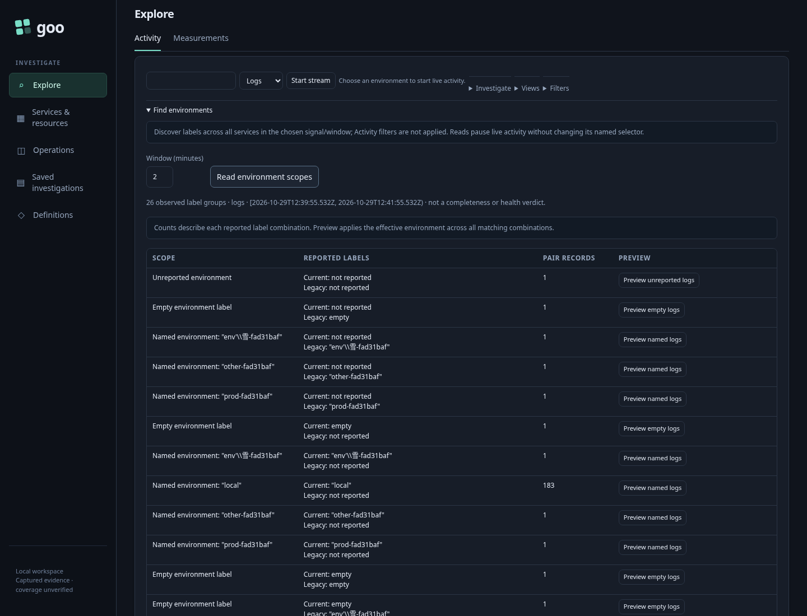
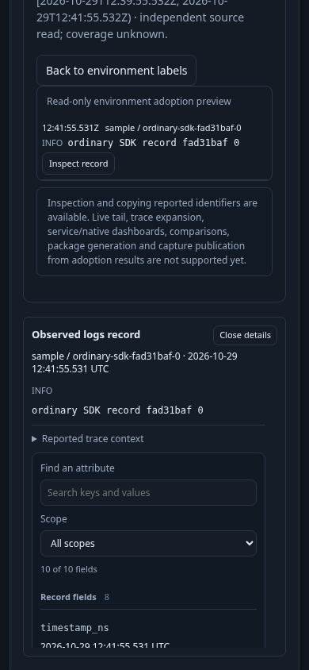

# Inspect SDK telemetry without an environment label — 247

An engineer has ordinary OTel logs/spans but sees no records in a named scope.
Under Activity they expand **Find environments** and explicitly read a bounded
window. Nothing is queried merely by opening the tool. Observed combinations show
current and legacy labels, absence versus empty values, winning-key provenance and
conflicts. Counts describe combinations, not totals for the next preview.



They preview **Unreported**. The tool independently reads records with neither
key present, reveals the result window and offers local inspection through the
shared table and attribute viewer. Closing inspection restores the opening control;
Back to labels adds no source read. Neither the main named selector nor a stored
question is changed. Unsupported capture/trace/tail/dashboard actions are explained
rather than reconstructed with a lost scope.



[Playwright](247-environment-adoption.spec.js) emits 25 current/legacy presence/value
combinations for both logs and spans through real OTLP into the lab ClickHouse.
It uses an empty one-millisecond historical window inside the 24-hour exporter TTL
and compares SQL results against independent matching logic for absent, empty,
named, quoted/backslash and Unicode labels. Old named queries still return their
current-key-only population. UI checks use a test-driver clock for that fixture
window; this is not a product clock override or a future-dated retention fixture.

The UI task verifies deliberate reads, unchanged named input, unsupported actions,
keyboard inspection/return, compact mobile composition, stale minute-change
responses and leaving/returning through measurement mode. Optional Bombadil uses an additional owned current-time SDK log fixture,
previews unreported logs in the normal recent window, inspects, closes and observes focus
return before completing. It rejects unexpected source/publication paths. Hegel
checks the logical presence matrix, literal binding and absence of a zero wildcard.

```sh
GOO_ENVIRONMENT_ADOPTION_BOMBADIL=1 \
 npx playwright test journeys/247-environment-adoption.spec.js
```

The only telemetry mutations are namespaced test fixtures, which expire under the
existing collector TTL. Temporary runtimes/stores are removed. No live definition,
annotation, immutable capture, index or data volume is rewritten. No new Quint
model is introduced for this stateless selector cut; property checks and actual
SQL equivalence complement the existing formal campaigns. Full Activity→fixed→
capture scope propagation remains the next A0 slice.
