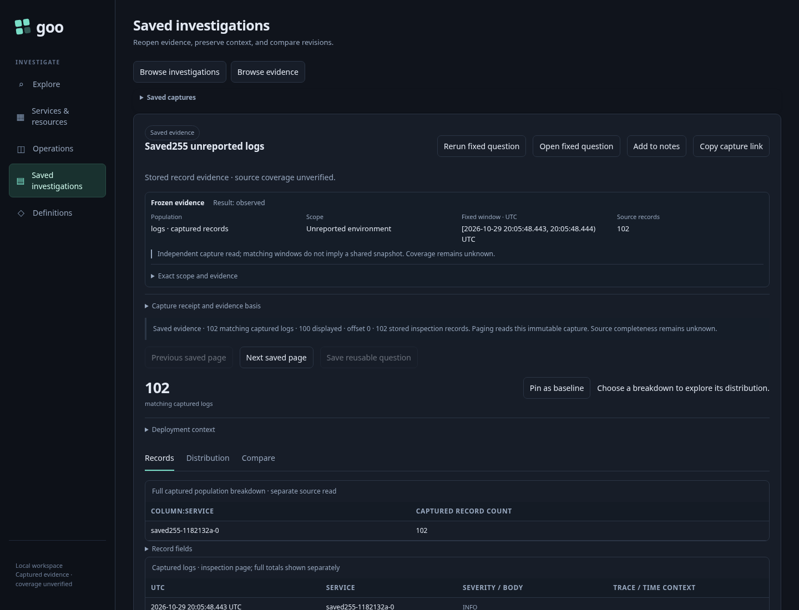

# 255 — Saved selector captures

[Executable journey](255-saved-environment.spec.js) emits ordinary OTel logs/spans
with absent, empty, conflicting and named environment labels. It uses isolated
capture stores; fixtures expire through the existing exporter TTL.

1. Create filesystem captures through the record API. Reopen all missing/empty/
   named scopes and both named policies in Saved. Inspect attributes locally:
   zero telemetry POSTs. Policy remains explicit and unsupported package and
   deployment actions stay disabled.
2. Page through 102 retained unreported logs and back. Pages are immutable custody
   reads with actual offsets; the receipt scope and ID remain unchanged.
3. Request surrounding logs explicitly: this is a new source read in the original
   environment/window. Refuse a wrong-policy context response. Stage the original
   fixed question without reading; Run explicitly preserves its selector.
4. Reopen saved comparison and observed explanation captures with no source read.
   Reuse explanation stages its request; Run explicitly rereads the fixed scopes.
5. Reject a stored response whose scope differs from its receipt. Preserve the
   error against racing catalog metadata. Reject a self-consistent refresh that
   changes the predecessor or immutable question. Ignore a late stored response
   after another capture opens.
6. The optional Bombadil campaign uses the existing read-only Saved actor for
   scope disclosure, next/previous, distribution/records and attribute inspection.
   It additionally checks selector package/deployment guards and requires actual
   completion; no source refresh or publication action is part of that actor.

```sh
GOO_SAVED_SELECTOR_BOMBADIL=1 npx playwright test journeys/255-saved-environment.spec.js
```



Selector entry from Activity preview remains a separate follow-on. Shared authored
question/step links and XTDB retention do not gain support from reopening a capture.
