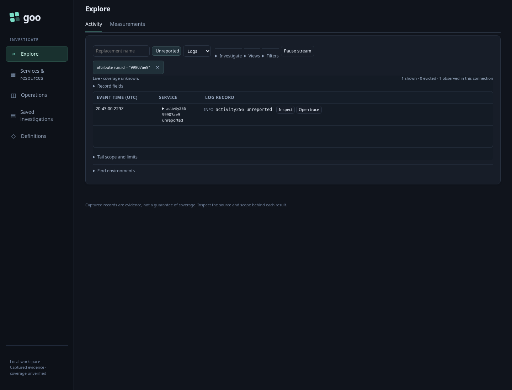
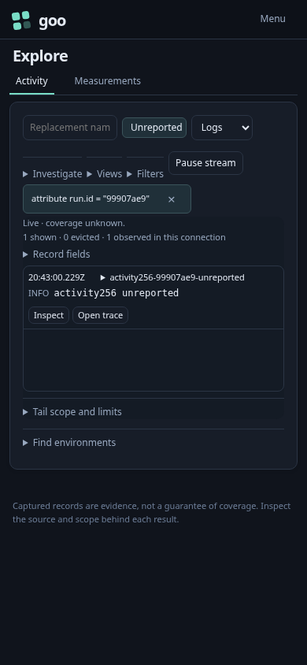
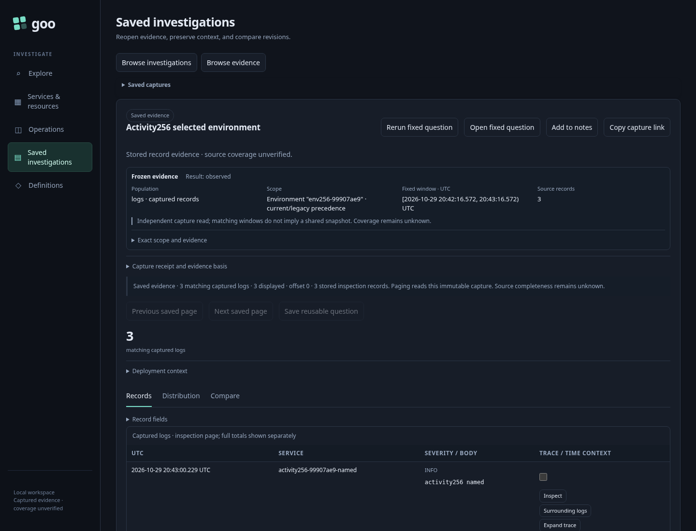

# 256 — discover → Activity → investigate → preserve

[Executable journey](256-activity-environment.spec.js) uses ordinary OTel logs and
spans with unreported, present-empty and conflicting named environment labels.
Its portable attribute filter is deliberately independent of environment labels.

1. Open **Find environments**, read bounded label groups and preview a scope.
   Preview ignores Activity filters; **Stage in Activity** keeps those filters.
   Only a checked, current preview can stage; an invalidated old button does nothing.
2. Stage the environment. Old rows, context, selection, return state and baseline
   references clear. No read starts. A compact policy tag identifies the scope and
   the existing **Start stream** action receives focus. Changing the staged signal
   does not subscribe. Opening another saved view uses the existing Keep/Discard
   choice; keeping the pending scope makes no source read. Incompatible filters
   stay visible and block execution.
3. Start explicitly. Both logs and spans retain the selected policy and predicates.
   Pause and inspect local rows. Unsupported selector XTDB retention actions are
   unavailable even when the server issued a membership capability.
4. **Analyze this scope/window** stages the completed fixed window without reading.
   Run explicitly, then **Return to paused activity** restores the held rows without
   another source read. Signal changes retain the selected environment.
5. Capture the fixed question through the existing dialog. Saved reopens the exact
   question and retained records without a source read; current/legacy conflicts
   remain current-key-first. Editing the environment name deliberately replaces
   the selector with the historical current-key-only named scope.







The optional Bombadil actor follows discovery → preview → stage → explicit Start
→ pause, requires completion, checks scope/predicate identity, refuses implicit
subscriptions and asserts selector retention stays unavailable:

```sh
GOO_ACTIVITY_SELECTOR_BOMBADIL=1 npx playwright test journeys/256-activity-environment.spec.js
```

This completes the bounded A0 record loop. Shared authored links, reusable
view/package intent, native/service families and XTDB selector retention remain
explicitly unsupported. It does not imply ingestion completeness or healthy data.
