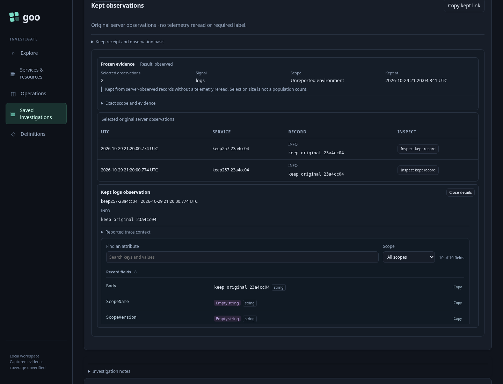
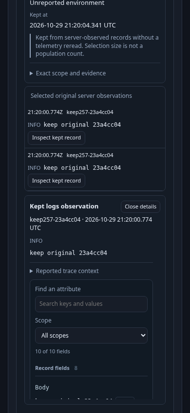

# 257 — Keep before interpreting

A developer sees two identical log occurrences in an unreported environment.
They want to keep what they saw before deciding what either occurrence means.

1. Discover and stage the unreported scope. Start Activity explicitly.
2. Select the two real SDK-exported records. The stream pauses; Keep needs no label.
3. Keep selected. The test deliberately loses the acknowledgement after commit.
4. Retry unchanged keep. The request ID and all references remain identical.
5. Open saved. Both original records remain, with distinct occurrence keys.
6. Inspect the original window/basis and observation clock; close returns focus.
7. Reload the exact link with no telemetry POST. An unknown link shows a visible
   requested-ID error while identifying any previously opened evidence.
8. Retry an unavailable pending keep. The visible reason survives list updates;
   Forget removes only the local retry record.

[Executable Playwright journey](257-kept-observations.spec.js) uses an isolated
Go server/storage and the real OTel collector/ClickHouse lab. The optional
`GOO_KEEP_BOMBADIL=1` campaign drives discovery → Start → Select → Keep → Saved →
Inspect → Close with one publication and no source reread after selection.

Actual desktop frame:

Actual 390px frame, with details opened at the mobile viewport:

Future fixed-result/Saved origins and cross-browser catalog browsing are planned,
not represented as implemented steps here. See [contract](../docs/KEPT_OBSERVATIONS.md).
