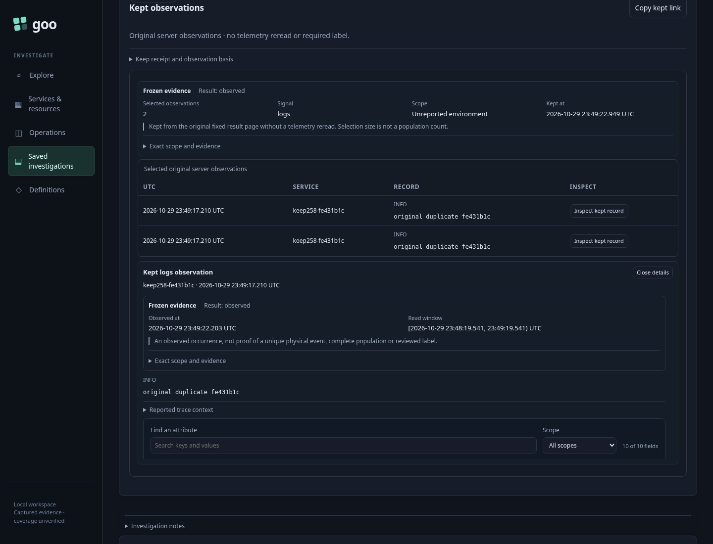
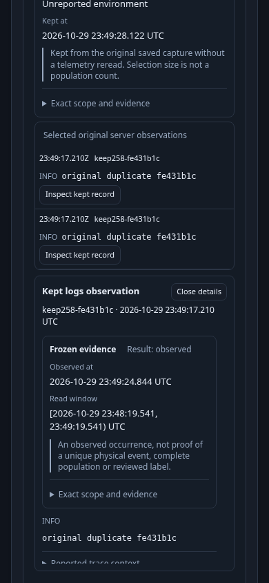

# 258 — Keep what a fixed or Saved page actually showed

A developer investigates an unreported environment containing 102 identical log
occurrences. They need two observations from the second page, not a fresh query
that happens to match the same fields.

1. Stage the checked environment, explicitly Start/Pause Activity, then Analyze/Run.
2. Go to fixed result offset 100 and select the two displayed records.
3. Keep without a title or annotation. The test loses the committed acknowledgement;
   unchanged retry keeps page-local indexes 0 and 1 and the original question offset.
4. Open saved and inspect original provenance before the attribute viewer. Duplicate
   contents share a digest but remain two selected positions. No telemetry is read.
5. Separately create a fresh population capture, open its second Saved page and select
   its two stored records. Keep uses absolute bank indexes 100 and 101.
6. Open the same Saved observation view on mobile, inspect and reload its exact link.
   The original source-read time, capture custody time and keep time remain separate.

[Executable journey](258-keep-records.spec.js) runs real OTLP/ClickHouse data with
an isolated Go server/storage. It asserts the exact POST effects and payloads,
selector identity, duplicate multiplicity, lost acknowledgement and keyboard/mobile
inspection. No lab capture is published. `GOO_RECORD_KEEP_BOMBADIL=1` adds Saved
paging → Select → Keep → Open → Inspect → Close, asserting one publication, absolute
indexes and no telemetry POST.

Server-wide Keep discovery, optional annotations and whole-trace graph retention
are planned. [Contract and diagram](../docs/KEPT_OBSERVATIONS.md).
