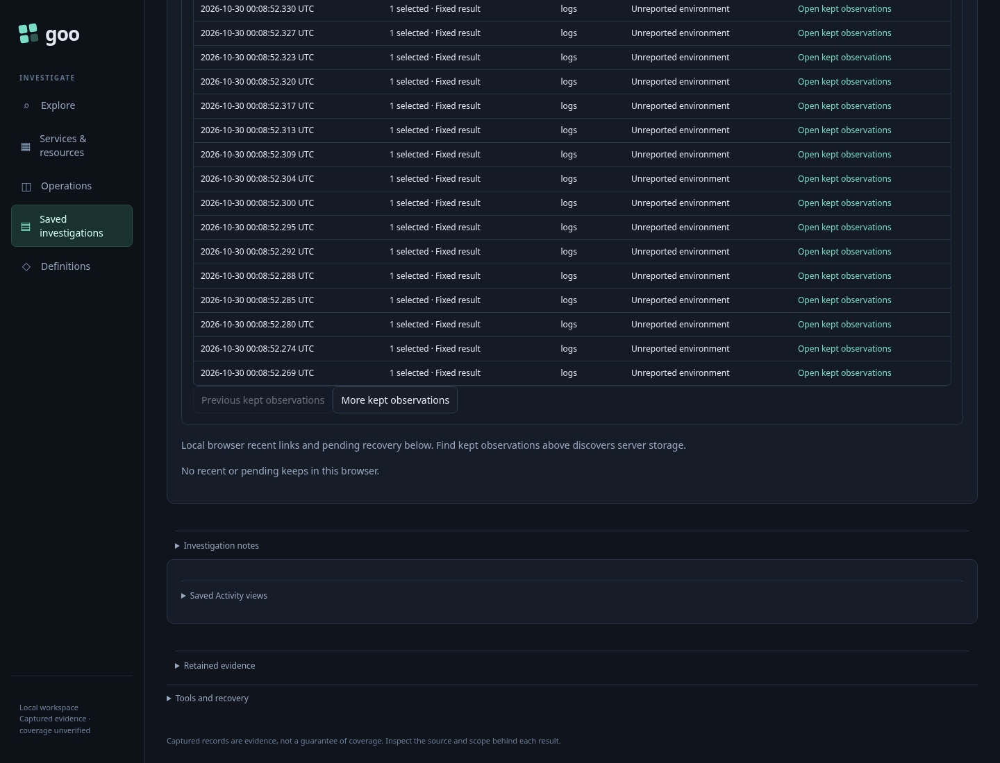
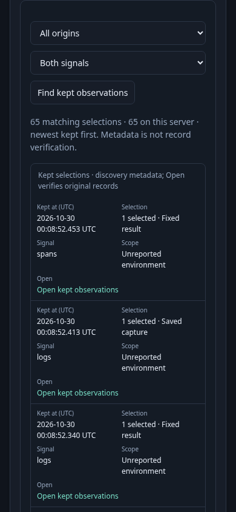

# 259 — Find kept observations from another browser

A developer kept interesting observations during an investigation. A teammate
opens a browser with no local recent history and needs to find those exact keeps.

1. The first browser keeps an actual SDK-exported Activity observation. The isolated
   fixture adds fixed/Saved keeps over the same real logs and spans: 65 selections,
   three origins and two signals. Original payloads and indexes stay immutable.
2. A clean browser opens Saved → Browse evidence → Kept observations and pending
   keeps. Opening the disclosure sends no discovery request. Local recent storage
   is empty. Find reads server metadata and shows 20 selections.
3. More/Previous page the applied query. Choosing Spans stages a filter with no read;
   Find returns the single matching selection.
4. Open kept observations verifies and shows its original span. No telemetry read
   or publication occurs in this browser's discovery/inspection task.
5. The isolated test removes only the derived index. Find refuses visibly; exact
   links still work. Repair verifies its first64 resources, but the test holds the
   acknowledgement. Collapsing the disclosure aborts and prevents the second batch.
6. Reopen explicitly. Find still refuses the incomplete index; Repair restarts safely
   and completes two bounded batches. Find returns all65 metadata selections again.
7. Repeat the discovered layout at390px with no horizontal overflow.

[Executable journey](259-kept-discovery.spec.js) uses a real collector/ClickHouse
and an isolated temporary Go server/store. `GOO_KEEP_DISCOVERY_BOMBADIL=1` adds a
40s discovery→page→filter→exact open→inspect→close campaign with four explicit
metadata reads and zero POSTs. No fixture keeps are published to the lab store.

Metadata is discovery, not record verification or classification. The
[contract and diagram](../docs/KEPT_OBSERVATIONS.md#server-discovery-and-bounded-repair--259)
state admission, resumable repair and remaining limits.
