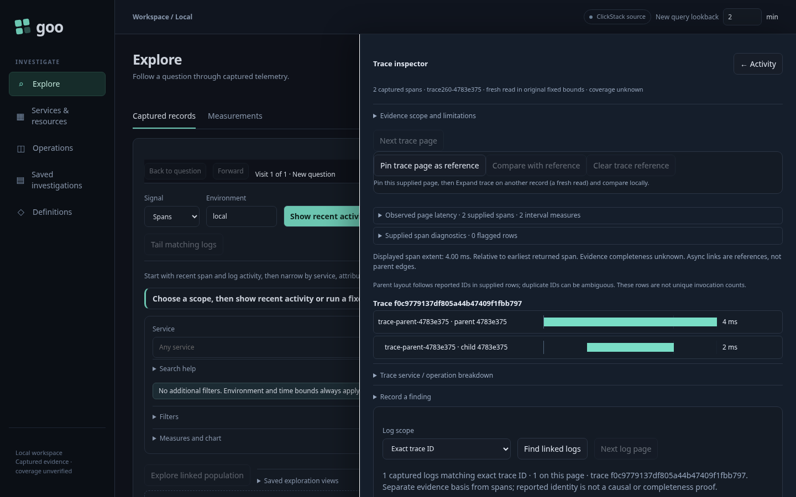
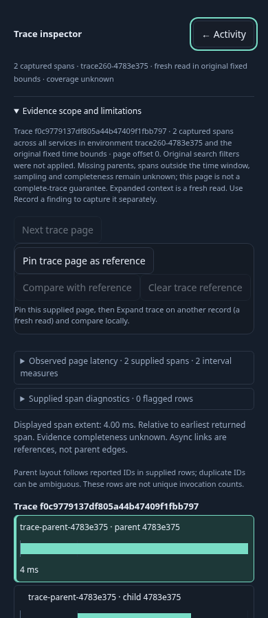
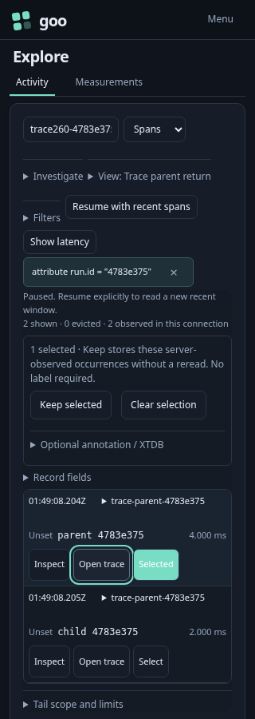

# 260 — Follow a trace and return to the record you selected

A developer selects an Activity occurrence, opens its trace, and needs a reliable
way back to the same held observations on a phone or keyboard.

1. A real SDK fixture emits a parent/child span trace and one linked child log.
   Start the saved Activity selector explicitly, then select one occurrence. The
   stream pauses with its selector and row identities retained.
2. Open trace. A native modal shows the trace in the original window and a visible
   **← Activity** exit. This broad context read remains separate from the held rows.
3. At1440px, ordinary close returns to the selected row. At700px, Shift+Tab/Tab
   stay inside the inspector, then Enter on close returns to Activity.
4. At390px, search an actual span's attributes. Escape in that input, Log scope
   select and an evidence disclosure leaves the inspector open. Touching the exit
   returns to the visible Activity opener.
5. At320px, Escape from the close control returns directly. Every return preserves
   row keys, selected count, selector and paused state with no source or stream read.
6. Close a trace while its source response is held. Releasing that old response
   does not restore the modal, move parent focus or issue the linked-log request.
7. Open a trace from fixed results, then from an immutable Saved capture. Their
   ordinary close returns to their own record row; the Activity callback does not leak.

[Executable journey](260-trace-parent-return.spec.js) uses isolated Go storage,
real collector/ClickHouse data, keyboard and touch input. Set
`GOO_TRACE_PARENT_BOMBADIL=1` for the modal/Activity return campaign; its actions
require completed source context before closing, held selection and visible parent
focus afterward, with one stream connection and no return-triggered source read.

[Interaction contract and diagram](../docs/TRACE_PARENT_RETURN.md). Native dialog
behavior is checked in Chromium; browser/assistive-technology matrix expansion is
future validation, not claimed by these frames.
