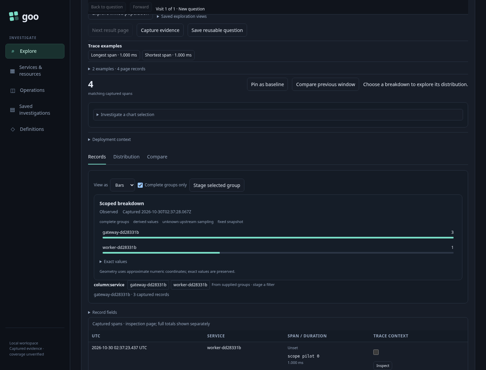
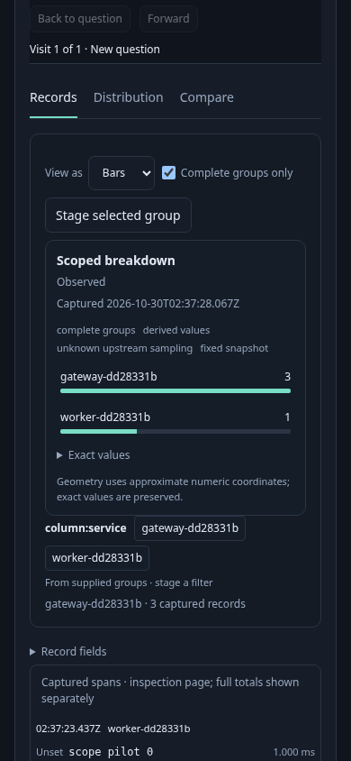

# 261 — One scope, several views

Implemented in [261-scoped-breakdown.spec.js](261-scoped-breakdown.spec.js).
The journey creates two independently instrumented services via OTLP with3 and1
captured spans. It verifies ClickHouse ingestion before opening the generic Goo
runtime. No synthetic UI dataset stands in for the integration journey.

| User action | Visible result | Source/effect contract |
| --- | --- | --- |
| Run a fixed service-grouped span question | Two bars with3/1 exact counts, captured UTC clock and quality facets | One explicit exploration request; Go attests complete groups, upstream sampling unknown |
| Require complete groups and switch to Table | Same category/count values in the shared table | No source request; same dataset/revision/scope |
| Select a row, then switch back to Bars | Exact selected group remains inspectable | Local selection only; no record-membership claim |
| Inspect on desktop and390px | Compact shared chart, facet and controls | Exact values accessible in a table; no horizontal page overflow |
| Click a service facet | Child fixed question staged; Run focused | No read; original environment, window and predicate preserved |
| Run the child question | One service group | Second explicit read; new applied dataset |
| Dispatch forged/retired scope intents | Current result stays applied | No stage, read or context replacement |
| Inject a changed-between-read response after a real third read | Diagnostic result; no complete-only geometry or narrowing controls | No stale successful chart substitutes for missing eligibility |

`verification/bombadil/scoped-breakdown.ts` follows the same public UI through
Run → Table → Select → Stage → Run. Its invariant rejects exploration reads outside
Run phases and its eventual assertion requires observed completion. The campaign
is optional locally via `GOO_SCOPED_BOMBADIL=1`; validation records actual execution.

Standalone `scripts/check_scope_components.cjs` tests SSR attributes, pre-upgrade
and detached SPA assignment, exact numeric strings, uncertainty/complete-only
refusal, missing data, native numeric line and narrow layout without app IO.
The model ledger records settled source counters and the harness ordinal of
observed successful applied Runs (not opaque dataset generation tokens); it is a
bounded effect-ownership check, not a whole-product liveness or query-truth proof.
