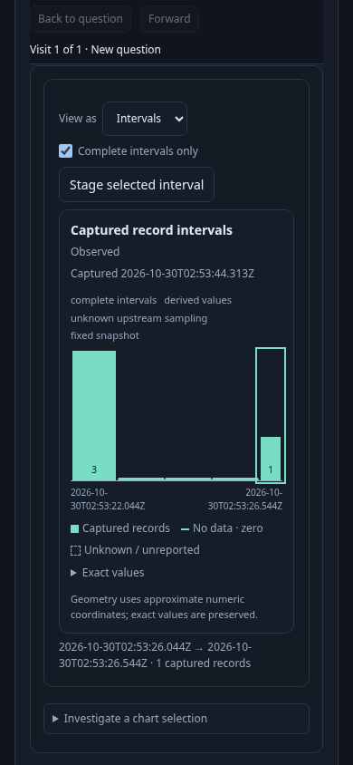

# 262 — Follow an interval, then a grouped population

Implemented by [262-scoped-intervals.spec.js](262-scoped-intervals.spec.js).
The test instruments gateway and worker services with four real OTLP spans and
verifies ClickHouse independently before opening Goo. The fixed4.5-second query
has five intervals: counts3/0/0/0/1; the last interval is500ms wide.

| User action | Visible result | Execution contract |
| --- | --- | --- |
| Run a route/service-grouped count question with1s buckets | UTC interval chart plus all-dimension count table | One explicit request; interval and group snapshots from existing bounded reads |
| Require complete intervals and switch to Table/back | Same exact interval bounds/counts/states | No query; clipped final width is half the ordinary width |
| Focus the last interval and press Enter | Exact UTC500ms window and count1 selected | Local inspection; no query |
| Stage selected interval, then Run | Child fixed window retains environment and predicate | Staging causes no read; Run is the second request |
| Select a grouped row, stage and Run | Both route and service predicates applied within the child window | Staging causes no read; Run is the third request |
| Invoke a retired interval control | Current applied result remains | No query or active context replacement |
| Reuse a Saved question with effective environment policy | Fixed question stages before Run; interval narrowing retains that policy | No name/wildcard fallback; two further explicit Runs |

`verification/bombadil/scoped-intervals.ts` follows Run → Table → Select interval →
Stage → Run → Select group → Stage → Run. Its invariant rejects unexpected reads;
its eventual assertion requires the final applied result. Enable the35-second
campaign with `GOO_INTERVAL_BOMBADIL=1`.

The compact model trace projects observed successful applied Runs onto an ordinal
and retains real source-request counts. The shared Quint checker rejects illicit
read/generation mutations on local operations. This is a bounded ownership model,
not a proof of whole-product liveness or source truth. Component/contract tests
separately cover unknown rows, unreported gaps, false completeness and SSR use.
