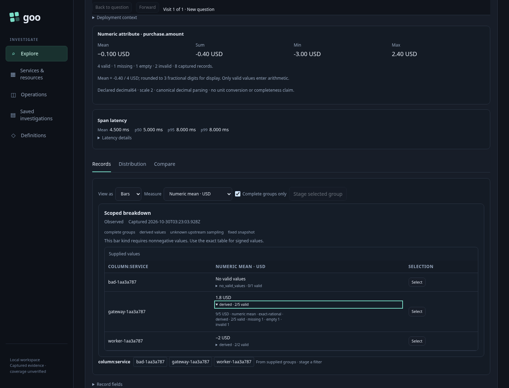
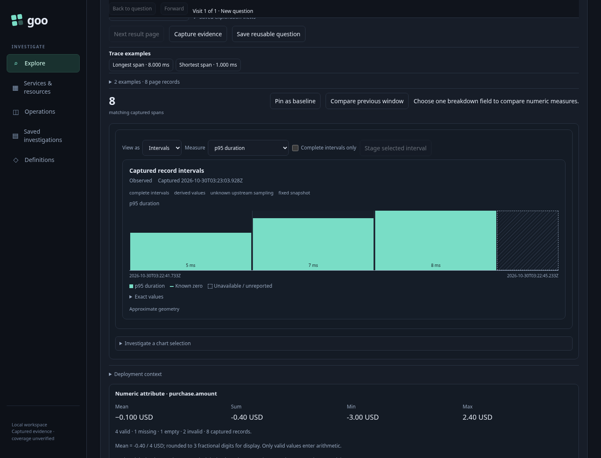
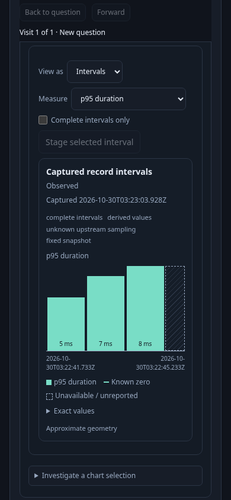

# 263 — Inspect a measure, then narrow its population

Implemented in [263-scoped-measures.spec.js](263-scoped-measures.spec.js).
Three real OTLP services emit eight spans. Gateway has five records, two valid
USD values and one each missing/empty/invalid. Worker has two valid negative
values; the third service has an invalid-only value. Durations are1–8ms.
ClickHouse ingestion is independently verified before Goo opens.

| User action | Visible result | Execution/semantic contract |
| --- | --- | --- |
| Run grouped numeric+span-summary question | Count chart, typed measure choices and interval chart | One explicit request; existing aggregate reads only |
| Choose numeric mean | Signed-value table fallback; gateway1.8 USD, worker−2 USD, invalid-only unavailable | Same snapshot; gateway exact9/5,2/5 valid; unavailable sum is null |
| Focus and expand gateway mean details | Selectable exact9/5 USD, method and support partition | Keyboard precision access, no query |
| Switch to span p95, table and back | Captured empirical quantiles in human duration units | ExactHigh method preserved; no average of percentiles; no query |
| Choose interval p95 and inspect desktop/mobile | True bounded intervals, no-data/gap semantics retained | Exact measure and support stay separate from geometry |
| Select interval, stage and Run | First fixed bucket with numeric binding and span summary intact | Staging reads nothing; second explicit request |
| Select service group, stage and Run | Same declared measures within the narrowed service/window | Third explicit request; measure choice retained |
| Invoke retired staging control | Current applied result remains | No query or active context replacement |

`verification/bombadil/scoped-measures.ts` switches numeric mean → p95 → interval
p95, then stages/runs interval and group scopes. It rejects reads outside explicit
Run phases and requires the final applied result. Enable the35-second campaign
with `GOO_MEASURES_BOMBADIL=1`; validation records executed outcomes.

Standalone Chromium checks cover exact rational/large decimal disclosure with
keyboard and touch, support/method/unit presentation, estimated hatching,
unavailable gaps, signed fallback and aggregate-facet refusal, plus existing SSR
and no-IO contracts. Go/JS/Hegel check mathematical/partition invariants separately;
the observed Quint replay is a bounded effects check, not a statistical proof.
