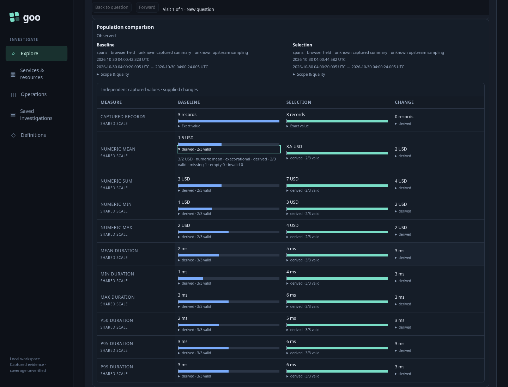
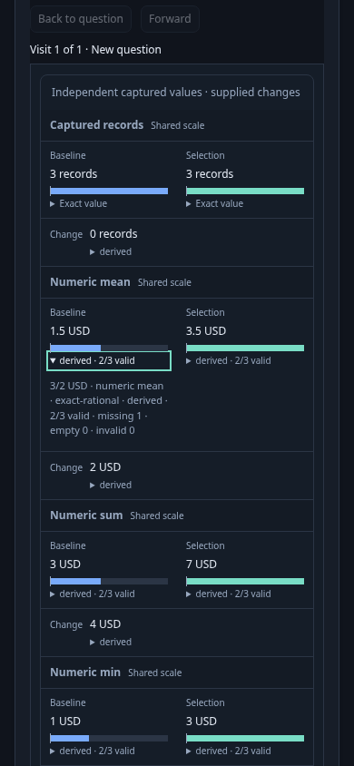

# 264 — Inspect independent populations

Implemented by [264-summary-comparison.spec.js](264-summary-comparison.spec.js).
Six real OTLP spans form two captured populations within the same fixed window.
Baseline numeric values1.00/2.00/missing produce exact3/2 USD; selection values
3.00/4.00/invalid produce7/2 USD. Their supporting partitions differ. Duration
p95 values are3ms and6ms. ClickHouse is checked independently before Goo opens.

| User action | Visible result | Contract |
| --- | --- | --- |
| Run baseline question | Compact population measures with exact/support disclosures | One explicit telemetry read; source summary aspect only |
| Pin baseline | Two independent held sides initially show equal values | Comparison validates supplied evidence; no telemetry read |
| Change phase filter | Draft question, pinned baseline retained | No telemetry read |
| Run selection | Exact numeric difference2 USD and p95 difference3ms | Second explicit read; baseline scope/basis/clock unchanged |
| Expand baseline mean with keyboard | Selectable3/2 USD and2/3 valid support | No query or comparison recomputation |
| Inspect at390px | Shared signed scale, both side values/clocks and exact details | Baseline, selection and change visible together; exact details do not misalign scales |
| Supply contradictory delta | Successful table clears and explicit refusal appears | No invented correction, telemetry read or stale success |

`verification/bombadil/summary-comparison.ts` follows Run → Pin → edit filter →
Run → inspect, requiring observed completion and only expected source/comparison
requests. Enable with `GOO_SUMMARY_BOMBADIL=1` for the35-second campaign.

The dedicated Quint model distinguishes current population and pinned baseline:
Run advances current; Pin captures its role; local staging/inspection/refusal must
preserve both. Recorded generations are harness ordinals of observed results,
not the DTO's content-based generation. Negative controls include accidental
baseline retargeting. This bounded check is not an authority or liveness proof.
