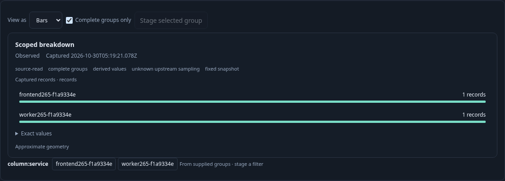
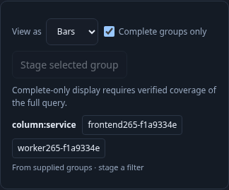
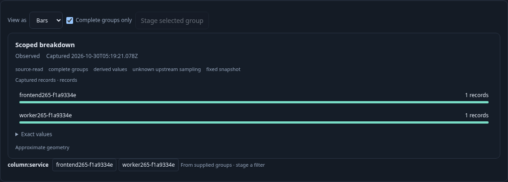

# 265 — Reuse source data without inheriting its guarantees

Implemented by [265-snapshot-boundary.spec.js](265-snapshot-boundary.spec.js).
Two ordinary OTLP spans from distinct services are verified independently in
ClickHouse before Goo runs one fixed question. The UI uses the resulting real
source snapshot. The next steps exercise the public embedding API; they do not
add test-only product controls or fabricate source data.

| User or extension action | Visible result | Contract |
| --- | --- | --- |
| Run and require complete groups | Both services remain visible | Host source adoption creates an immutable scoped handle; one `/api/explore` request |
| Supply a copied one-row JSON value | Complete-only display refuses | Import gets a new local identity and drops source guarantees despite copied flags |
| Select one source row with the public projection | Exact selected row can display with completeness disabled | Parent identity and frozen row are retained; full-query completeness is withheld |
| Restore the retained original handle | Complete-only display shows both services again | Original identity and private guarantee survive; no additional source request |
| Supply invalid replacement data | Prior geometry is withdrawn | Recovery requires supplying valid data again; no hidden successful fallback |

All local steps retain the original exact values and perform no telemetry read,
comparison request or subscription. The four-step observed ownership trace is
validated with the sibling observability repository's Go Quint tools, including
proof, read, row-count and origin negative controls and a completed-journey gate.
This is a projected local-ownership model, not authentication or proof of source
truth. The read counter counts Goo exploration requests, not the separate SQL
reads inside each request. Hegel tests cover additional proper subsets, all-keys
identity, private source instances, descriptor safety and admission budgets.

Optional `GOO_SNAPSHOT_BOMBADIL=1` explores the same actual source-backed question
through source/copy/subset/restore/invalid/completion phases. Raw campaign output
is disposable; a compact phase summary is sufficient for the validation record.

