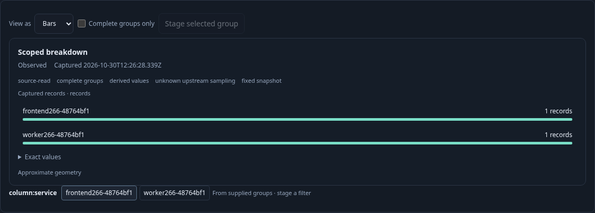

# Current execution owns scoped actions — 266

[Executable journey](266-scope-actions.spec.js) sends two real OTLP spans to the
collector, waits for ClickHouse, and runs the isolated Go application. It retains
actual facet elements and selected group/interval stage buttons, then invokes
their old callbacks after ownership changes, forcing click events even on disabled
buttons. This checks the host action pipeline; generated direct resolver checks
isolate its private fencing. No test-only product control or
fabricated source witness is used.

| User journey | Visible outcome | Boundary checked |
|---|---|---|
| Run a fixed question with groups and one-second intervals | Two services and a bounded timeline | The application binds admitted data to this execution |
| Rerun the unchanged finite population | Identical content revision, a distinct captured read clock | Old facet, group and window callbacks cannot stage the new execution |
| Leave Explore and return | Existing charts remain inspectable; staging is disabled until Run | Returning does not revive retained callbacks |
| Run again, select a current group and Stage | A fixed child question is staged; no source request | Current binding resolves known membership; Run stays explicit |
| Replay callbacks after staging, an edit or cancellation | The current draft/cancelled phase is unchanged | A retained closure cannot overwrite a later state |

## Documentation frames

- [Current scoped data](../docs/journeys/screenshots/266-current-scope.png)
- [Returning requires an explicit Run](../docs/journeys/screenshots/266-return-requires-run.png)
- [Current selection stages a child question](../docs/journeys/screenshots/266-current-selection-staged.png)

## Complementary checks

The Hegel suite runs 100 generated cases against the actual JS resolver and
Go-produced dataset DTOs. It drives real epoch callbacks, same-handle rebinding,
slot replacement, revocation, inactive/draft owners, named baseline roles,
foreign/cloned bindings, forged membership, exact direct projections and sibling
projection ownership. Resolution is pure: a fetch spy rejects any source IO.

The browser's seven-step Quint trace projects observed lifecycle boundaries into
a `fence` counter. This is explicitly **not** the application's internal execution
generation or an authorization token. It checks the observed stage/read effects
of source → rerun → stale refusal → suspend → suspended refusal → explicit new Run
→ current stage. Seven incorrect traces and an unfinished prefix must be rejected.
Reads count Explore requests, not the individual SQL reads inside a request. The
later cancelled request is intercepted before reaching Go and recorded separately.

The optional 35-second Bombadil campaign passed with 457 snapshots across all
nine phases, three explicit Explore requests, identical content revisions and
distinct read clocks. The real browser journey also passes the edit/cancel checks.
Compact campaign summaries and the small model trace are retained;
successful raw campaign screenshots/logs may be removed after validation.

These checks establish local host ownership and pure scope narrowing. They do not
authenticate a telemetry producer, prove atomicity across source reads, or prove
that all upstream telemetry was collected.

The journey also runs a legal parent with31 conditions (32 nodes including its
conjunction). Adding a facet would exceed the predicate budget: the UI reports
why it cannot stage, retains every parent condition and the applied display, and
issues no additional read. This branch is outside the seven-step projected model
and the three-request Bombadil campaign.

