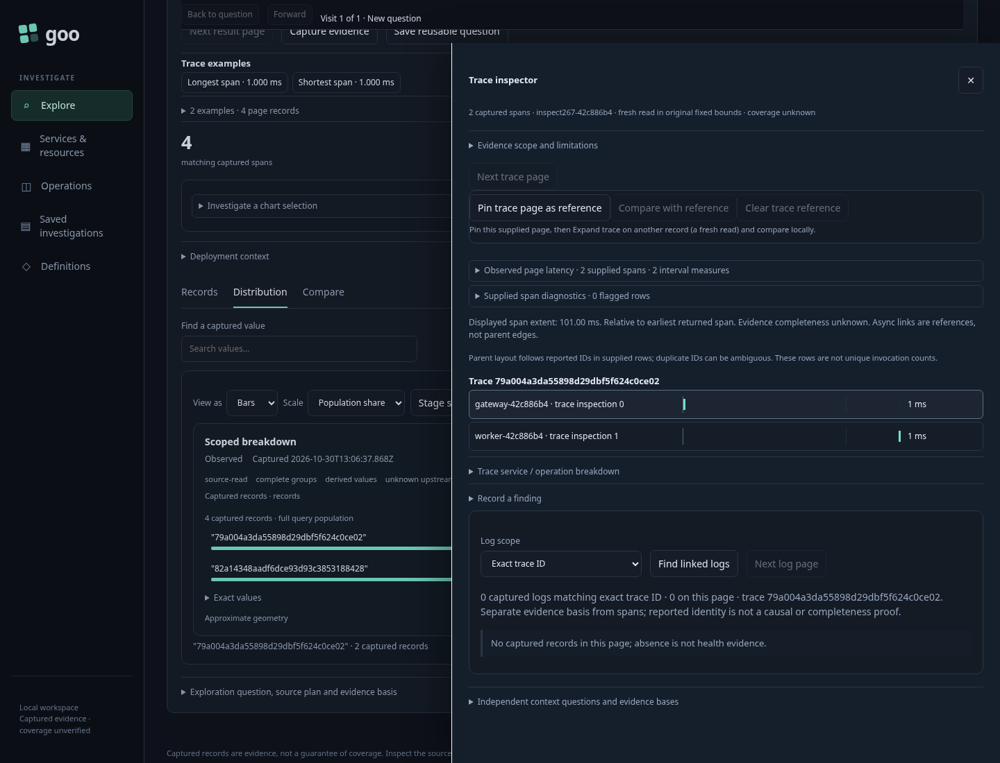

# One Distribution, one captured denominator — 267

[Executable journey](267-distribution-shares.spec.js) ingests four real OTLP spans:
three frontend records and one worker record. Both services use the same fixed
question and declared numeric/duration measures. ClickHouse ingestion is checked
independently before the isolated Go application's Distribution tab is exercised.

| Interaction | Expected result | Scope/effect boundary |
|---|---|---|
| Open Distribution | Shared canonical chart shows 75% / 25% | Denominator 4 comes from this exhaustive group read |
| Find worker, change order or view kind | Worker remains 25%, including bar width | Local presentation retains the original handle, denominator and scale |
| Choose numeric mean | Signed data uses the exact table with 1/3 valid support | No absolute-magnitude bars or hidden changes to numeric meaning |
| Pin baseline and rerun the same fixed question | Baseline keeps its captured question; rerun has same revision/new clock | Baseline and current execution remain distinct |
| Replay old chart/stage callbacks | No new draft or read | H1 host pipeline retires the previous execution |
| Stage current worker, then Run | Staging reads nothing; the new worker-only question shows 100% | Only explicit query narrowing changes the denominator |
| Open a Saved capture, Find worker | 25% remains; staging is absent | Read-only display uses its retained question and source coverage |

## Documentation frames

- [Find retains the full 25% share](../docs/journeys/screenshots/267-filtered-full-share.png)
- [Exact signed measures and support](../docs/journeys/screenshots/267-exact-signed-measures.png)
- [Saved read-only shares](../docs/journeys/screenshots/267-saved-read-only-share.png)

The Hegel suites exercise 100 generated cases using actual Go-produced DTOs and
actual JS share/Find/order helpers. They include missing vs present-empty groups,
uint64 extremes, exact zero/no-data, a larger separately read count, imported and
projected advisory metadata, partial coverage, and unchanged exact numeric cells
and support. Filtering produces a display row list, never a new measured scope.

The small observed Quint model checks source → Find → order → measure → rerun →
retired callback refusal → stage → explicit Run. Its counters project observed UI
effects, not private source proof or authorization state. It reads denominator/share
facts through the public API over the actual chart handle; the browser separately
asserts visible labels and bar widths. Seven incorrect traces
and an unfinished prefix must fail. Explore request counts exclude the explicit
Saved-capture read and data-only comparison requests; they do not count each SQL
statement inside a source request.

The optional 35-second Bombadil campaign passed with 537 snapshots across all
12 phases and three explicit Explore requests. The real browser journey also
passes the baseline, signed-measure, mobile-width and Saved read-only checks.
Retain compact summaries, the observed trace and current frames;
successful raw campaign logs/screenshots are disposable. Neither these checks nor
partition metadata prove complete upstream collection or source authenticity.

A [complementary trace journey](267-trace-inspection.spec.js) uses a legal parent
with31 conditions (32 predicate nodes). Group refinement refuses an additional
condition, while explicit trace inspection still reads spans and linked logs in
the original fixed environment/window. These are the existing inspector reads,
not part of the three-request share campaign or its projected model.

