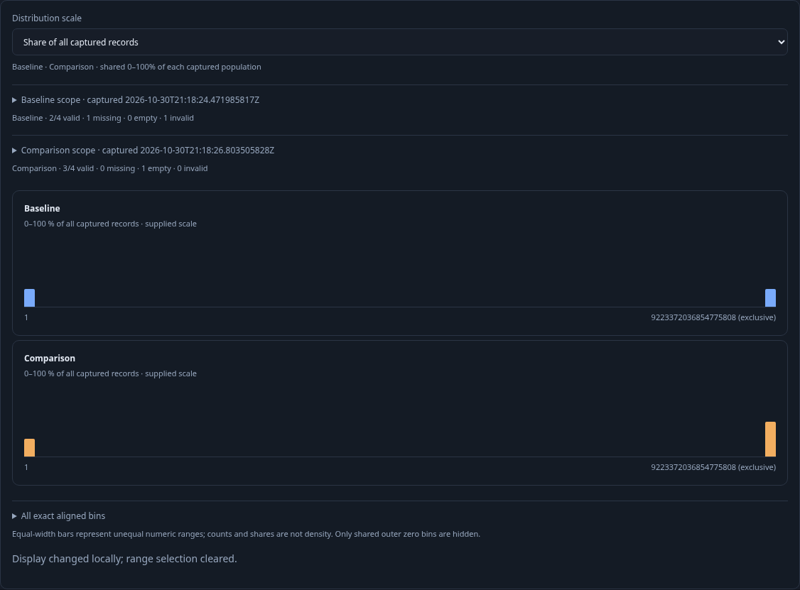
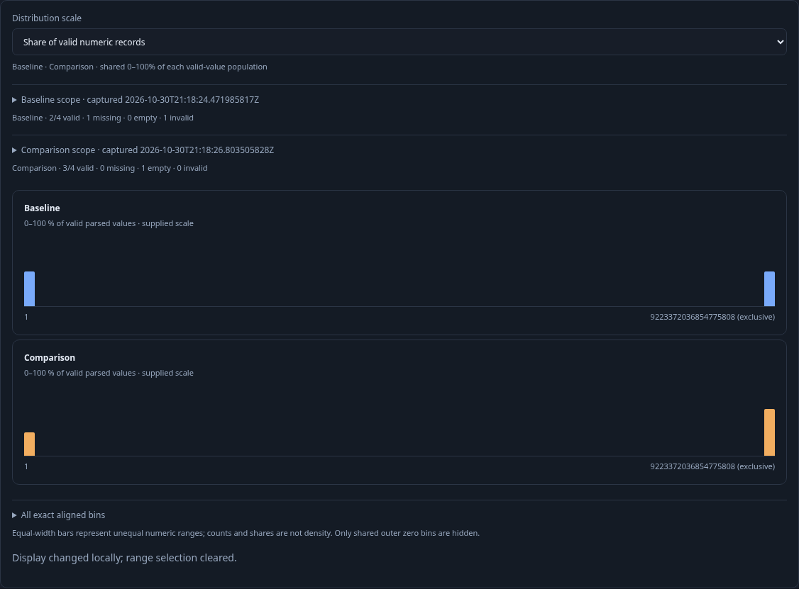
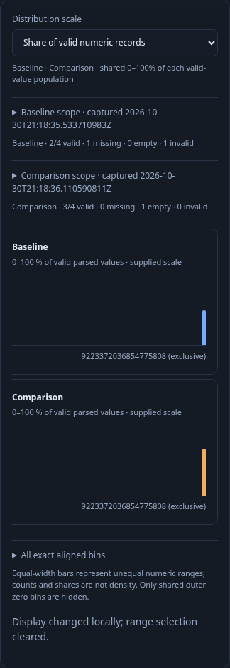

# Independent numeric histogram comparisons

A pair of recorded populations can share exact bins without sharing a denominator. This journey sends eight real OTLP spans to the lab collector and waits for ClickHouse ingestion. The baseline has four captured records, two valid numbers, one missing value and one invalid value. The comparison has four records, three valid numbers and one empty value. Both contain the maximum signed 64-bit value.

1. Run baseline, pin it, edit the population filter and run comparison. Opt into distribution comparison. The canonical `goo.histogram-comparison/1` wrapper retains each question and each support partition independently. Supplied counts are 1 versus 2 in the last bin; no data is pooled.
2. Choose **Share of all captured records**. The last bin is 25% versus 50%, using each side's four captured records. Scale changes perform no source read or planner call.

3. Choose **Share of valid numeric records**. The same immutable operands now show 50% versus exactly `200/3` percent. Missing, empty and invalid records remain visible in coverage. The display uses a shared 0–100% axis, never a separate maximum per side. Open the exact table to inspect all 128 bins and the exact exclusive endpoint `9223372036854775808`.

4. Select the baseline's final bin. Selection is local. **Open baseline range** asks the pure planner for a child of the captured baseline question and explicitly reads that fixed side, finding one record. The maximum-plus-one endpoint remains geometry; the planner does not emit an out-of-domain predicate value.
5. Capture and reopen the original comparison. Saved operands retain their independent questions and support. Opening a side is an explicit fresh read; local display changes do not read or alter the saved evidence. The 390-pixel view contains the shared chart scroll area without making the document overflow.

The real journey is [270-histogram-comparison.spec.js](270-histogram-comparison.spec.js). Its compact trace projects observed source/planner counts and public model values through source, population scale, valid scale, exact table, brush and explicit Open. The Quint model verifies local controls conserve reads, explicit Open adds one planner call and one selected-side source read. This is an observed display/effect model, not a proof of private source authority or action ownership. Seven altered traces and an unfinished prefix must be rejected.

The Hegel lane generates 100 actual Go `CompareCohorts` canonical responses and exercises the real JavaScript validator, immutable constructor and renderer model. It covers signed, unsigned and scaled decimal bindings, empty/no-valid operands, diagnostic operands, exact independent percentages, malformed geometry/accounting/bindings/environments/signals, no source authority after import and no display I/O. These deterministic Go fixtures use generated held cohorts; the browser journey separately tests the real ingestion/source path.

The final maintained Bombadil campaign passed for 35 seconds with **492 snapshots across 11 phases**, three explicit Explore reads and one side planner call. It reproduced independent scale changes, full exact bins and a maximum-bin side continuation without display-driven reads.

Retain the compact campaign summary, six-step trace and ledger under `artifacts/scoped-270`; successful raw campaign screenshots and trace directories are disposable. The three images above are the maintained documentation frames.
