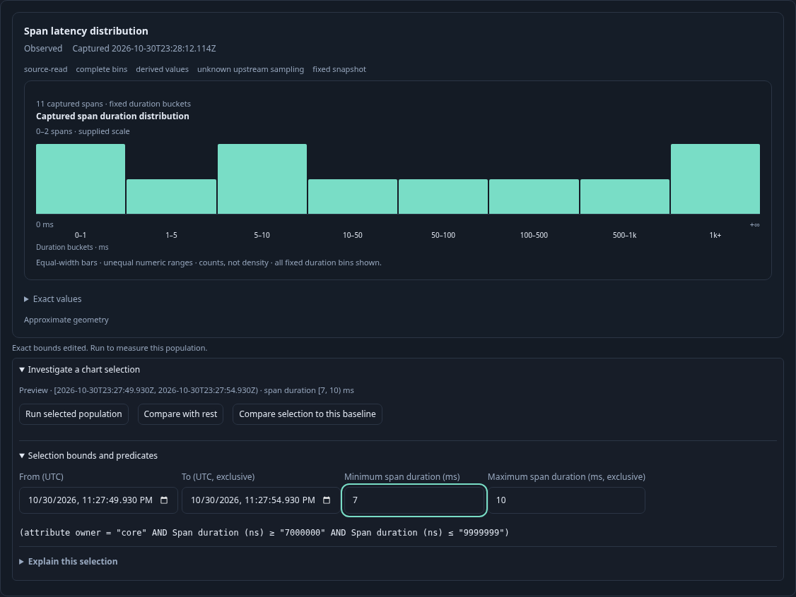
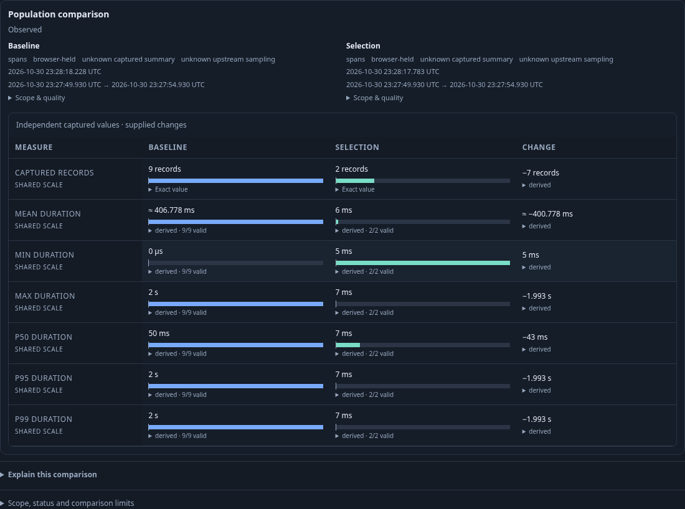
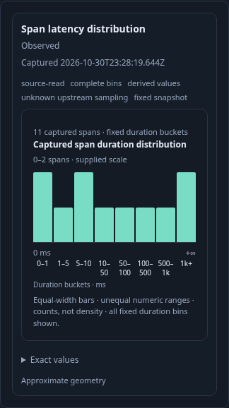

# Raw span durations in the shared histogram model

The same passive histogram component can display exact numeric attribute bins or fixed raw-span duration bins. The model tags their different semantics: `kind: numeric` carries numeric parse support; `kind: span-duration` carries the exact total from the exhaustive duration grouping read. No numeric binding or missing/invalid parsing partition is invented for duration bins. This is not a native OpenTelemetry histogram measurement.

This journey sends twelve real OTLP spans through the collector into ClickHouse. Eleven match the parent `owner = core` predicate; one outside span checks that selection retains the parent filter. Durations include zero, one nanosecond, every fixed lower boundary, seven milliseconds and two seconds. Eight bin counts are `2, 1, 2, 1, 1, 1, 1, 2`. The inspection page deliberately contains one record, while the fixed distribution represents eleven captured spans.

1. Run the parent question and open Distribution. The actual admitted source handle has eight exact bins, a private `bins` guarantee, finite nanosecond boundaries and an explicit `+inf` final upper bound. An empty bin is known zero only because the grouping read was exhaustive.
2. Select `[5, 10)` milliseconds with the keyboard. The passive component emits supplied stable bin keys; the host resolves them against the current action binding. This selects two of eleven captured spans without reading telemetry. Open **Selection bounds and predicates** and change the lower bound to seven milliseconds. Editing exact bounds clears the chart highlight and remains local.

3. Click **Run selected population**. One explicit source read finds the seven-millisecond span. The child keeps the parent's owner predicate and half-open interval semantics; `+inf` is never serialized as a predicate value.
4. Return to the parent and explicitly run it again. Its content basis is identical while its capture clock changes. Forcing the retained old chart/tray callbacks has no effect. This exercises the browser effect pipeline; direct action-context tests separately verify private ownership fencing.
5. Select `[5, 10)` again and choose **Compare with rest**. Staging performs no source read. **Run population view** independently reads the selected population and its disjoint remainder, yielding two selected spans and nine baseline spans.

6. Capture the original parent and reopen it. The Saved histogram retains all eight bins and the exact eleven-span total. Its selection tray is absent, and the 390-pixel view stays within the document width.

The [real journey](271-duration-histogram.spec.js) uses actual ingestion and source responses. The Hegel lane separately generates 100 actual Go source DTOs and executes the real JavaScript contract: 60 duration cases, 20 malformed-family/geometry/accounting cases and 20 tagged numeric nonregressions. Boundary cases include one nanosecond, exact fixed edges, known empty distributions, sparse groups and the maximum uint64 count. Four additional source controls withhold canonical duration snapshots for unknown, missing, duplicate and overflowing duration groups. Imported histograms retain exact supplied values but lose the private completeness guarantee.

The eight-step observed Quint model checks public retained-bin facts and explicit read/comparison effects. It does not claim a proof of private action authority, source authenticity, native histogram compatibility or atomic reads. Seven altered traces and an unfinished prefix must fail. The maintained Bombadil campaign passed for **35 seconds with 491 snapshots across eight phases**. It exercised source-bound selection, exact manual edits, resetting the supplied bin range, source-free rest staging and three explicit Explore reads plus one comparison.

Retain only the compact trace, ledger and campaign summary under `artifacts/scoped-271`, plus these three documentation frames.
