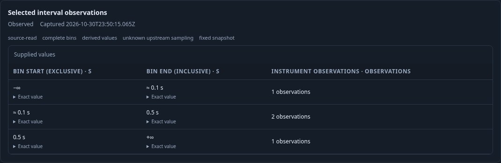
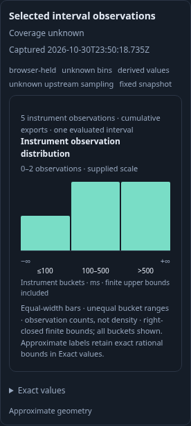

# Inspect one native instrument interval

A native duration instrument records observations, independently of captured span
records. The shared histogram model now distinguishes this grain, its right-closed
explicit buckets and evaluated delta/cumulative interval semantics. It does not
infer contributing spans or turn an instrument bucket into a duration filter.

The [executable journey](272-native-histogram.spec.js) sends real OTLP delta and
cumulative histograms through the collector into ClickHouse. Each has one exact
resource/scope/metric/attribute stream. The delta stream includes a known interval,
a no-recorded-value interval, a later known zero interval and a changed layout.
The cumulative stream has a known increment followed by a decrease diagnostic.
These incomplete windows intentionally test that a selected known interval is
usable without claiming whole-window collection coverage.

1. Run the delta measurement and select its first interval. Open **Selected native
   bucket counts**. The same passive `goo-chart` used for captured-record
   histograms now displays three native observation buckets: one, two and one.
   Its scope contains the checked measurement, complete stream identity and exact
   selected interval. The edges retain `-inf` and `+inf`; the binary64 source
   value 0.1 is retained exactly as `3602879701896397/36028797018963968`.
2. Switch **Native histogram display** to Table. Exact rows, right-closed ranges,
   observation units and total remain unchanged. The switch reads no telemetry.

3. Select the later known zero interval. All three explicit bins remain known
   zero; the percentile is unavailable because there are no observations.
4. Select the no-recorded-value interval. The shared histogram disappears and its
   diagnostic remains. No fallback to the preceding known data or fabricated zero
   distribution is permitted.

5. Run the cumulative instrument and select its evaluated interval. Two cumulative
   export rows have counts 2 and 7; subtraction yields five observations with bucket
   increments 1,2,2. The measurement's three retained export records are not the
   interval's observation denominator. The subsequent decrease remains unknown.
6. Capture and reopen the result in another 390px browser. Selected interval
   histogram/table inspection performs no source reads and offers no raw-span
   range actions. Original units, clocks, bounds, count and temporality remain. Held snapshots
   have no private complete-bins witness. Open native charts use normal page
   scrolling; unknown interval inspectors keep their bounded detail pane.

The property lane generates 100 cases from the actual Go measurement evaluator and
compares the pure Go and JavaScript one-interval constructors. Exact subnormal and
maximum finite binary64 bounds, empty bounds, known-zero and maximum uint64
populations are included, alongside malformed union/scope/accounting controls.
The observed browser trace checks explicit measurement reads and local
known/table/zero/unknown/Saved transitions. Seven altered traces and an unfinished
prefix must fail. The Saved Bombadil campaign explores known/table/zero/unknown
inspection without POST requests. These checks do not prove source authenticity,
upstream completeness or private execution authority.

Only compact ledgers, model trace and campaign summary are retained under
`artifacts/scoped-272`; these documentation frames come from the real running app.
