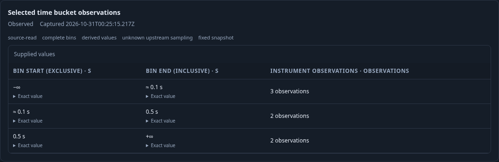
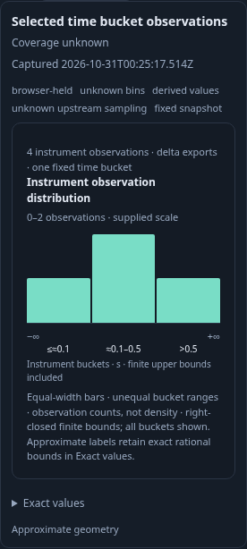

# Inspect complete native histogram time buckets

The fixed-time view combines whole evaluated export increments into windows
anchored at the exact question start. A selected time bucket now projects into
the same passive histogram/table model as a selected export interval. Its selector
retains width, index, exact clipped bounds, parent question and exact stream.
The native count is instrument observations, not captured export records.

The [executable journey](273-native-time-histogram.spec.js) ingests nine real OTLP
histogram exports through the collector into ClickHouse. Four-second windows
combine two-second exports even though the per-export gap policy is only three
seconds. The five bucket states are observed, unavailable, known zero,
unavailable and observed. The final bucket is clipped to three seconds.

1. Run the measurement once and inspect the first fixed-time bucket. Two exports
   contribute seven observations. Source admission verifies the selected bucket
   scope and derived source-basis chain. Exact binary64 bounds and infinite tails
   retain right-closed instrument semantics.
2. Switch to Table, then export intervals and back to fixed-time buckets. These
   are local display operations; the retained histogram and its seven observations
   do not change and no source request occurs.

3. Select the known-zero window. It retains three zero bins and no percentile.
   The evaluator's `empty-distribution` reason is a valid known-empty result.
4. Select the missing-value window and the incompatible-layout window. Neither
   supplies a histogram or falls back to a previous known bucket. An independent
   three-second-width request confirms that crossing export increments are
   unavailable rather than split or interpolated.

5. Select the final bucket. Four observations retain the actual three-second
   interval and declared four-second width. Capture and reopen in another 390px
   browser. Saved inspection uses held data without private completeness, does
   not POST and keeps the native chart out of the generic nested-scroll pane.

The property lane constructs actual Go measurement/evaluator results, comparing
Go and JavaScript projections for complete, empty and clipped buckets, delta and
cumulative exports, extreme bounds and malformed scope/source-basis policy.
The observed Quint model checks public selected-bucket facts and explicit browser
measurement effects. Mutants and incomplete prefixes must fail. The Saved
Bombadil campaign explores known, table, zero, unknown and final states with no
POST requests. These checks do not prove source authenticity or upstream collection
completeness. Explicit capture remains a separate source operation.

Keep compact ledgers/model trace/campaign summary and these real frames; remove
raw successful campaign output and disposable isolated capture stores.
