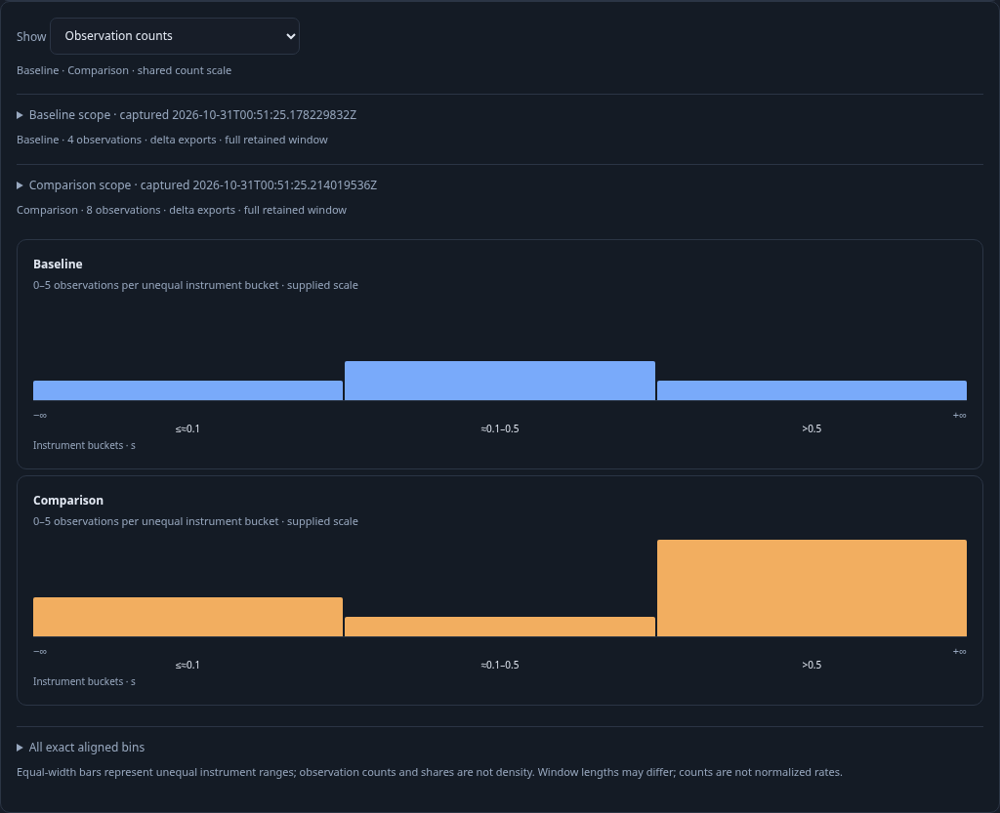
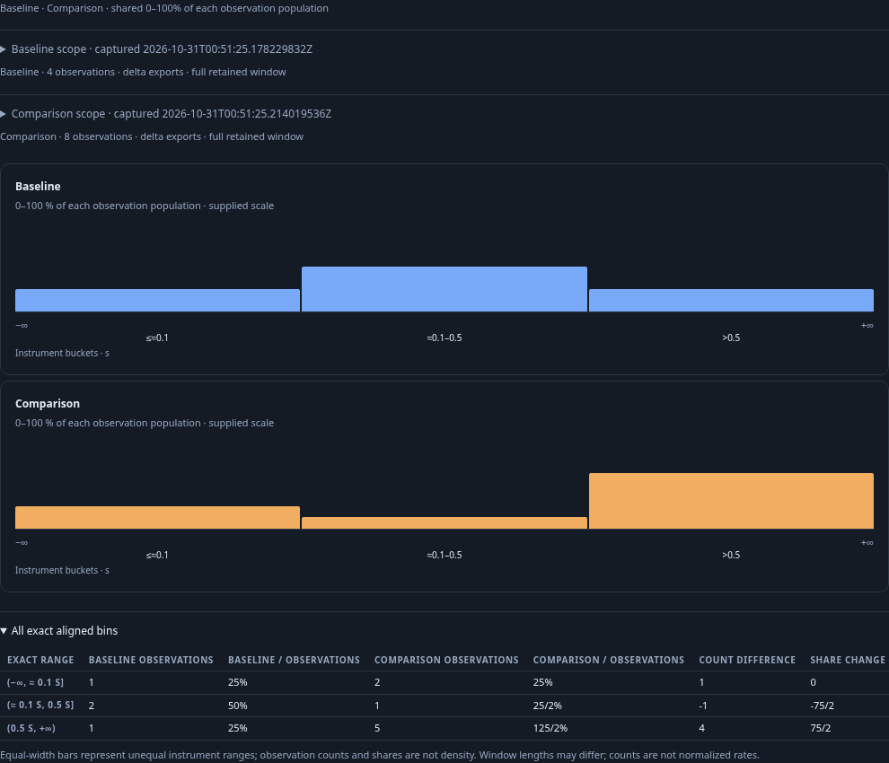
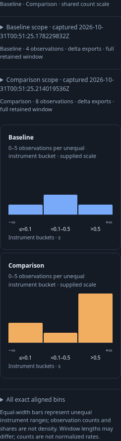

# Compare captured instrument populations

This journey uses Goo's existing investigation and saved-comparison flow. It
replaces the duplicate native percent chart, raw bucket table and optional
count heatmap with one shared aligned histogram and its exact table. No new
comparison screen, source query or native contributor-span claim is added.

Two real OTLP duration populations use the same exact stream and bucket layout.
The baseline window is four seconds and has two export rows totaling four
observations; the six-second comparison has three export rows totaling eight.
The bins contain `1,2,1` and `2,1,5`. Their different window lengths stay visible;
raw count differences are not rates.

1. Open the existing investigation and compare its linked captures. Count is the
   initial scale, shared across both sides at five observations. Complete stream
   identity, independent questions, capture clocks and coverage stay inspectable.
   Both operands are held and have no private source completeness.

2. Switch locally to observation share. The axis stays at 0–100%; each side uses
   its own observation total, yielding 25/50/25% versus 25/12.5/62.5%. Open the exact
   table to inspect rational bounds and values. The display emits no native
   record-population range actions, and local changes perform no source reads.

3. Save the comparison to the investigation and reopen it in another 390px browser.
   It uses the retained receipt and compact window metadata, not fresh telemetry
   or a synthetic source result. Count/share and exact inspection remain local.

4. Compare known-empty, missing/gapped, incompatible-layout and mixed-quality
   stream cases. Existing whole-comparison withholding remains authoritative;
   no aligned pair or new share/delta is displayed. Coverage reasons and known
   side values remain available. P95 remains a bucket-range relation, never an
   interpolated scalar difference.

The executable journey uses actual collector/ClickHouse data and the existing
comparison API. Go↔JS properties separately validate actual native evaluator
outputs, independent clocks/windows, compatible identities/layouts and malformed
or withheld inputs. The observed Quint trace constrains local comparison effects;
mutants and unfinished prefixes must fail. Saved Bombadil explores count/share
and exact disclosure without source requests. These checks do not establish
upstream ingestion completeness or authenticate arbitrary imported data.
