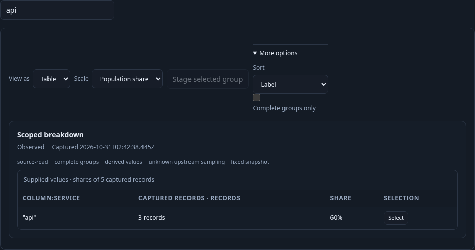
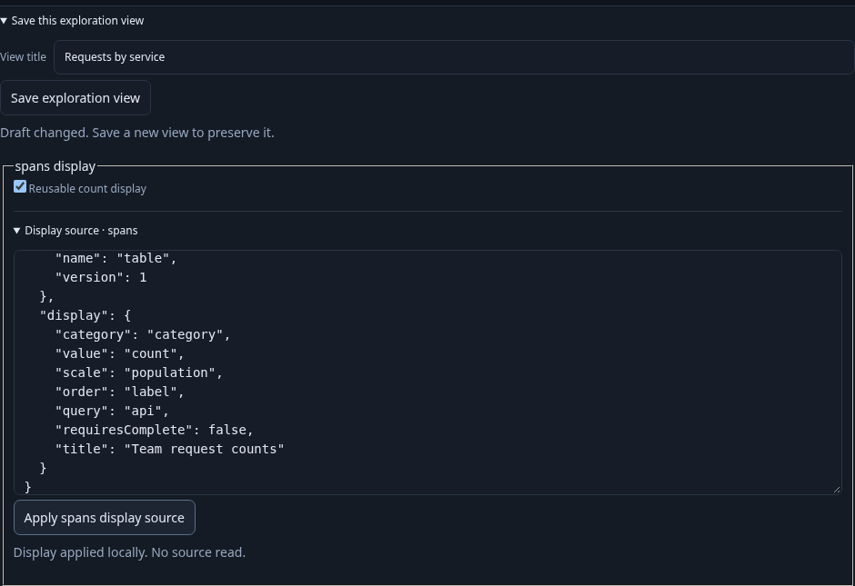
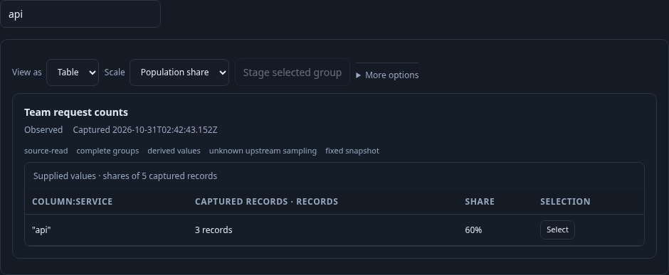

# 275 · Reusable count displays

An operator has scoped recent spans to an environment and grouped them by service. The same checked query can now carry a reusable bar/table display in an immutable exploration-view configuration. The first authored profile covers ordinary single-field record counts; native, multi-field and temporal profiles remain explicit unsupported choices.

The executable journey is [275-view-authoring.spec.js](275-view-authoring.spec.js). It emits real OTLP spans into the lab collector, waits for ClickHouse, then opens the existing exploration workspace. Three `api` and two `worker` records make five matching records; the inspection page is limited to one row.

1. **Choose a local display.** Enable the reusable spans count display, switch to Table, order by label, and Find `api`. The visible group remains 60% of five captured records, even though only one inspection row is loaded. These display edits make no source reads.

   

2. **Inspect and apply the declaration.** The bounded `goo.view/1` JSON names the existing record-query signal and a pinned bar/table kind. The operator titles the chart `Team request counts`. Invalid or unapplied JSON preserves the last good preview and disables Save; property edits preserve the unapplied source draft. Apply validates and updates the local preview without a source read.

   

3. **Save and reopen.** Save creates an immutable exploration-view ID containing the typed query and display intent. Opening it stages configuration with zero additional reads and no retained chart data. Run explicitly reads telemetry again and restores the same title, table, Find and ordering. A late successful save response cannot label a subsequently edited draft saved.

   

Validated against the running Go application and real OTLP/ClickHouse data on 2026-10-31. The browser journey passed with exactly two source reads: the first Run and the explicit Run after reopening. It confirmed a five-record denominator despite a one-row inspection page, invalid-source Save blocking, and an ignored late save response after a newer draft edit. All three frames above came from that run.

The companion finite Hegel checks passed 40 valid and 40 refusal Go↔JavaScript declaration cases; a real store sequence reopened twenty immutable revisions. The observed browser ledger passed Quint validation, six altered-trace negative controls and unfinished-prefix rejection. A 30-second Bombadil campaign passed with 613 snapshots covering Run, local sort, invalid source, Apply, Save and configuration-only reopen; its final state was staged with one source read and no viewport overflow. These checks cover public configuration/read boundaries, not private completeness authority.
