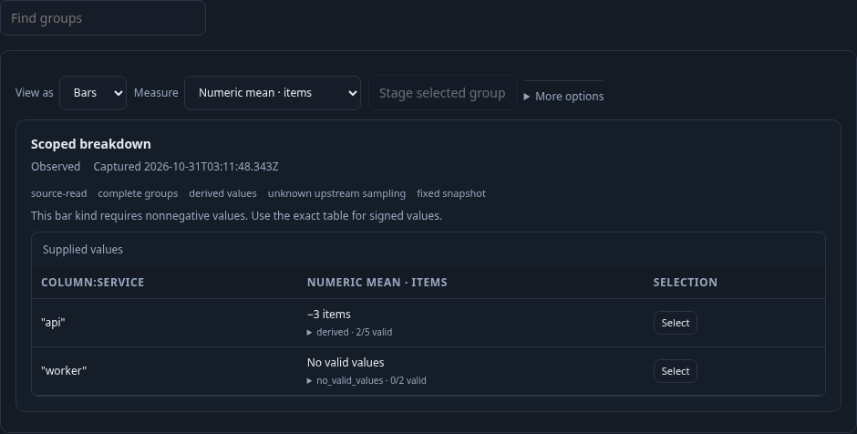
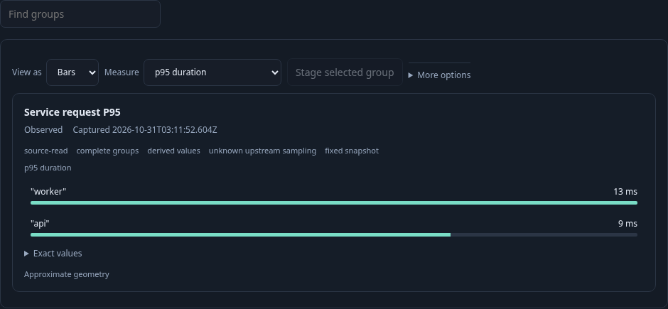

# 276 · Reusable numeric and duration measures

An operator has grouped ordinary spans by service and declared a numeric field's
unit/type plus a span-duration summary in the checked query. The existing saved
display can now select compatible aggregate fields without changing that query.
[Executable journey](276-saved-measures.spec.js) supplies seven real OTLP spans:
five `api` and two `worker` records, with only one inspection row requested.

1. **Inspect signed numeric support.** Select Numeric mean. The requested bar kind
   stays in the declaration, while signed values use the shared exact-table fallback.
   `api` is −3 items from two valid values among five records; missing, empty and
   invalid values remain separate. `worker` has no valid values, rather than zero.
   The measure switch makes no telemetry read.

   

2. **Switch to a duration measure.** Select P95 duration. The same captured groups
   show 9 ms and 13 ms using exact empirical quantiles, not an average of percentiles.
   Units and exact/support disclosures come from the canonical dataset. A source
   declaration requesting population share for a duration is refused and disables
   Save while the previous valid preview remains.

   

3. **Save and reopen intent.** Apply a valid title/source, save through the existing
   immutable view catalog, reopen without reading telemetry, then Run explicitly.
   The selected P95 field, query binding, units and title return. Switching fields,
   source edits and save/reopen require no additional source reads.

   

Validated on 2026-10-31 against the running Go application and real
OTLP/ClickHouse records. The journey passed in 1.0 minute: exactly two telemetry
reads (initial Run, explicit Run after reopening), seven matching records despite
a one-row inspection page, numeric mean −3 items with 2/5 valid support, unavailable
worker numeric values, and exact per-service P95 durations 9/13 ms. Returning to
Count exposed the count-only share control and displayed ≈71.4% for 5/7 records;
returning to duration restored `max` scale without a read. Invalid non-count share
source blocked Save and preserved the last valid preview. All three frames are
from this run.

The finite Hegel checks passed 50 valid and 50 refusal Go↔JavaScript declaration
cases. Quint validated the nine observed steps with read counts
`[0,1,1,1,1,1,1,1,2]`, rejected six changed traces, and rejected an unfinished prefix.
A 30-second Bombadil campaign passed 557 snapshots across all nine phases,
including signed numeric fallback, duration switching, invalid scale, Apply, Save
and configuration-only reopening. Its final state was staged with one source
read, no viewport overflow and no uncaught errors. These checks cover public
configuration/read boundaries; they do not assert complete upstream telemetry.
