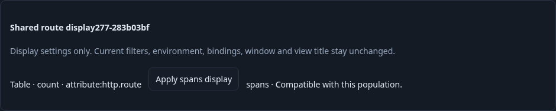
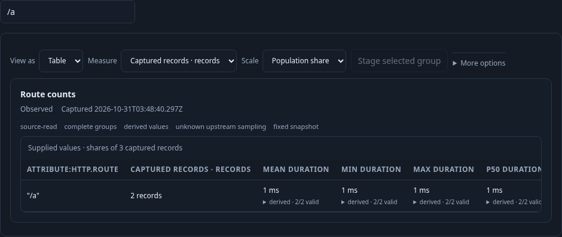
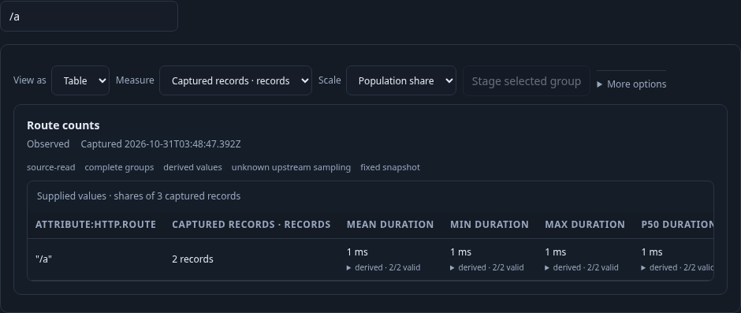

# 277 · Reuse a display in the current population

[Executable journey](277-display-reuse.spec.js) starts with real spans in Activity,
groups observed `http.route`, explicitly runs that analysis and opens its linked
population. A saved table comes from a different environment, time window and
predicate; only its display intent is reusable.

1. **Inspect compatibility.** Load the existing saved-view catalog. Opening the
   catalog reads summaries, not every saved definition. Inspect explicitly fetches
   one configuration and checks signal, qualified grouping, selected measure and
   numeric quantity/unit compatibility. A resource-vs-attribute grouping mismatch
   refuses Apply. A delayed response after a destination title edit is retired;
   an older A response cannot replace a newer B preview. Pending and held baseline comparisons block
   Apply until explicitly cleared.

   

2. **Apply locally.** Apply imports a table with Find `/a`, label order and
   population-share scale. The retained captured population has three records;
   `/a` remains two of three (≈66.7%). No telemetry read occurs. Current queries,
   predicates, environment, window, layout, columns, other-signal settings, tail
   configuration and view title stay owned by the destination.

   

3. **Save a distinct configuration.** Save retains the destination questions and
   creates a new immutable revision. The original source saved view remains
   unchanged. Reopen stages configuration; explicit Run reads the current fixed
   questions and recreates the same table.

   

Validated on 2026-10-31 with the real OTLP/ClickHouse pipeline. The browser journey
passed in 59.1 seconds. Its six source reads comprise one fixed analysis, two linked
population reads, one explicit previous-window comparison probe, and two reads after
reopening and explicitly running. Inspect, Apply, Save and configuration-only reopen
added zero telemetry reads. The observed read ledger is `[3,4,4,4,4,4,6]`; original
source configuration and destination questions/layout/columns/other-signal settings
remained unchanged. Both stale-response guards and pending/held comparison refusals
passed. All three frames above came from that run.

Finite Hegel checks passed 50 valid and 50 refused Go↔JavaScript checked-query reuse
cases, including input immutability. The seven-step observed Quint replay passed
in 5.40 seconds and rejected five altered traces plus an unfinished prefix. A
30-second Bombadil campaign passed 539 snapshots across eight phases: initial,
Run, catalog, Inspect, Apply, Save, reopen and complete. Its final configuration
was staged with two explicit population reads and no viewport overflow or uncaught
errors. These are public configuration/read checks, not upstream completeness claims.
